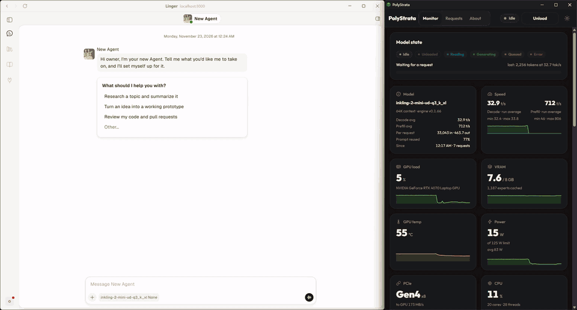

<h1 align="center">PolyStrata</h1>

[English](README.md) · [简体中文](README.zh-CN.md) · [日本語](README.ja.md) · [Deutsch](README.de.md) · [Français](README.fr.md) · **Español** · [Português](README.pt-BR.md) · [Türkçe](README.tr.md)

<p align="center"><b>Ejecuta modelos de IA grandes en tu propio PC</b><br>
Qwen3.8-Flash-Next, Hy4-Flash, GLM 5.3 Flash, DeepSeek V4 Flash, LFM2.5, Flint, Qwen3.6, Clover, Ornith 1.5, Gemma 4, Tiel Coder, MiniCPM-V y Kolibri 1 · libre y de código abierto</p>

<p align="center"><a href="https://github.com/simplexai-labs/linger"></a></p>

<p align="center"></p>

<p align="center"><br>
<sub>Claude Code con Qwen3.6-35B-A3B UD-Q3_K_M en el portátil con la tarjeta de 8 GB, en tiempo real: añade una opción <code>--json</code> a un programa pequeño, escribe una prueba y ejecuta las pruebas. El servidor había leído el prompt de sistema de Claude Code al arrancar (<code>"warm_start": true</code>).</sub></p>

<p align="center"><br>
<sub><a href="https://github.com/simplexai-labs/linger">Linger</a> sobre PolyStrata: Inkling 2 Mini UD-Q3_K_XL, en el portátil con tarjeta de 8 GB y a unos 33 tokens por segundo, escribe un pueblo low-poly en un solo archivo de three.js y Linger lo abre.</sub></p>

PolyStrata ejecuta modelos de IA grandes en un PC normal, modelos que normalmente necesitan un servidor.
Conversan, escriben código y funcionan con tus aplicaciones y agentes de programación. Nada sale de tu PC.

Ejecuta catorce modelos, con dos motores:

- **[Qwen3.8-Flash-Next](https://huggingface.co/Qwen/Qwen3.8-Flash-Next)** en una tarjeta gráfica NVIDIA o AMD de
  12 GB o más, en Windows o Linux. También entiende imágenes. Su motor es el de
  [Strata](https://github.com/Niko1221/Strata), sin cambios.

Los otros trece usan un motor escrito para PolyStrata, con una tarjeta NVIDIA o [dos](docs/MULTI_GPU.md#the-strata-poly-models): los trece en Linux, y todos menos GLM 5.3 Flash y
DeepSeek V4 Flash también en Windows. Son experimentales: solo han funcionado en un PC con una tarjeta de 32 GB, nueve de los más
pequeños además en un portátil con una tarjeta de 8 GB, y Groot en un PC con una RTX 5060 de 8 GB.

- **[GLM 5.3 Flash](docs/models/glm.es.md)**, el más grande: un archivo de 79 a 114 GB, que en su mayor parte se queda en la RAM.
- **[DeepSeek V4 Flash](docs/models/deepseek.es.md)**, un archivo de 91 GB, que en su mayor parte también se queda en la RAM. Su
  memoria de una conversación es pequeña: un contexto de 128K ocupa solo 0,7 GB más de VRAM que uno de 32K.
- **[LFM2.5-24B-A2B](docs/models/lfm25.es.md)** de Liquid AI, un archivo de 11 a 25 GB. La mayoría de sus capas no tiene
  atención, así que una conversación larga ocupa poca VRAM: un contexto de 128K solo ocupa 2 GB más que 32K. Su
  licencia solo permite el uso comercial a empresas que facturan menos de 10 millones de dólares al año.
- **[Flint 40B-A2.5B](docs/models/flint.es.md)** de Recursive, hecho para agentes de código: un archivo de 18 a 42 GB. La
  mayoría de sus capas solo mira 513 tokens atrás, así que una conversación larga ocupa poca VRAM: un contexto de 128K
  solo ocupa 2,6 GB más que 32K.
- **[Qwen3.6-35B-A3B](docs/models/qwen36.es.md)**, un archivo de 13 a 23 GB. También entiende imágenes.
- **[Groot 19B-A3B 261023](docs/models/groot.md)**, integración experimental en el instalador para tres cuantizaciones de
  Bartowski, Q4_K_M, Q6_K y Q8_0 (de 12,5 a 20,2 GB), con MTP y un proyector de imágenes opcional. Q4_K_M con texto ha
  funcionado en una RTX 5060 de 8 GB y en una RTX 5090 en Linux; las imágenes, Q6_K y Q8_0 siguen pendientes.
- **[Inkling 2 Mini](docs/models/inkling.md)** de Thinking Machines, experimental: un archivo de 9 a 18 GB. Ha funcionado
  en Linux con una tarjeta NVIDIA de 32 GB y en Windows con una tarjeta de portátil de 8 GB. También lee imágenes, una petición a la vez.
- **[Clover-35B-A3B-Preview](docs/models/clover.es.md)** de DiffuSpace, Qwen3.6-35B-A3B entrenado más para escribir
  también un bloque de tokens de una vez: un archivo de 13 a 21 GB. Solo lee texto.
- **[Ornith 1.5](docs/models/ornith.es.md)**, con la arquitectura de Qwen3.6-35B-A3B y otros pesos: un archivo de 14 a 24 GB.
  También entiende imágenes.
- **[Gemma 4 26B-A4B](docs/models/gemma4.es.md)**, un archivo de 11 a 17 GB. También entiende imágenes.
- **[Tiel Coder 35B-A3B](docs/models/tiel.es.md)**, Ornith 1.5 cuantizado por peculiar-ragdoll para agentes de
  programación: un archivo de 14 a 23 GB. También entiende imágenes.
- **[MiniCPM-V 4.7 35B-A3B](docs/models/minicpmv.es.md)** de OpenBMB, con la arquitectura de Qwen3.6-35B-A3B y pesos propios,
  hecho para leer imágenes: un archivo de 16 a 29 GB.
- **[Kolibri 1](docs/models/kolibri.es.md)** de Aleph Alpha, que escribe alemán tan bien como inglés: un archivo de 29 a
  48 GB, que junto a una tarjeta pequeña queda casi todo en la RAM.
- **[Hy4-Flash](https://github.com/Niko1221/Strata/releases/tag/v0.2.18)** de Tencent, 220B-A12B, en el motor propio del proyecto Strata (`strata-hy4`): un archivo de 130 a
  181 GB, desde 64 GB de RAM con una tarjeta de 8 GB. También lee imágenes.

El servidor puede cambiar entre los modelos instalados mientras está en marcha
([cómo](docs/BACKENDS.md#changing-the-model), en inglés).

PolyStrata fue creado por [VecSzn](https://github.com/VecSzn).
PolyStrata está hecho sobre [Strata](https://github.com/Niko1221/Strata) de Niko1221.
Por qué es un repositorio aparte, las tarjetas AMD y más pequeñas, los fine-tunes y otras preguntas: [FAQ](docs/FAQ.md) (en inglés).

## ¿Qué velocidad tiene?

Un token es más o menos ¾ de una palabra.

- **Escribe respuestas:** lo rápido que aparece la respuesta en un chat corto. 60 tokens por segundo es más rápido de lo que puedes leer.
- **Lee tu prompt:** lo rápido que procesa lo que le envías (aquí, un documento, código o historial de chat de 32K tokens).

La tabla da el tamaño que el instalador elige para cada modelo, en tokens por segundo. Los números de cada tamaño, la comparación con llama.cpp y cómo se midió están en la página de cada modelo.

| Modelo | Portátil con tarjeta de 8 GB<br>escribe / lee | RTX 5090<br>escribe / lee | Todos los tamaños |
| --- | ---: | ---: | --- |
| LFM2.5-24B-A2B | 86 / 4,035 | 492 / 25,275 | [LFM2.5](docs/models/lfm25.es.md) |
| Flint 40B-A2.5B | 64 / 2,643 | 261 / 15,033 | [Flint](docs/models/flint.es.md) |
| Qwen3.6-35B-A3B | 106 / 2,483 | 536 / 15,319 | [Qwen3.6](docs/models/qwen36.es.md) |
| Clover-35B-A3B-Preview | 83 / 2,242 | 308 / 13,918 | [Clover](docs/models/clover.es.md) |
| Ornith 1.5 | 87 / 2,362 | 366 / 14,438 | [Ornith](docs/models/ornith.es.md) |
| Gemma 4 26B-A4B | 92 / 2,187 | 370 / 11,478 | [Gemma 4](docs/models/gemma4.es.md) |
| Tiel Coder 35B-A3B | 89 / 2,517 | 440 / 15,109 | [Tiel Coder](docs/models/tiel.es.md) |
| MiniCPM-V 4.7 35B-A3B | 79 / 2,263 | 331 / 14,615 | [MiniCPM-V](docs/models/minicpmv.es.md) |
| Kolibri 1 | 66 / 851 | 207 / 6,133 | [Kolibri 1](docs/models/kolibri.es.md) |
| GLM 5.3 Flash | no funciona: necesita una tarjeta de 32 GB | 52 / 863 | [GLM](docs/models/glm.es.md) |
| DeepSeek V4 Flash | no funciona: necesita una tarjeta de 32 GB | 54 / 1,926 | [DeepSeek](docs/models/deepseek.es.md) |
| Inkling 2 Mini | 53 / 892 | 196 / 6,706 | [Inkling 2 Mini](docs/models/inkling.md) |
| Groot 19B-A3B 261023 | 97 / 2,785 | 458 / 15,634 | [Groot](docs/models/groot.md) |
| Hy4-Flash | no funciona: necesita 64 GB de RAM | 90-111 / 1,694 | [Hy4-Flash](https://github.com/Niko1221/Strata/releases/tag/v0.2.18) |

Portátil: RTX 4070 Laptop (8 GB), Core i7-14700HX, 32 GB de RAM. Estación de trabajo: RTX 5090 (32 GB), Xeon Platinum 8470Q (25 vCPU), de 90 a 120 GB de RAM. Flint es UD-Q3_K_XL en el portátil, el tamaño que el instalador elige con 32 GB de RAM, y UD-Q4_K_XL en la estación de trabajo. Kolibri 1 es Q2_K en los dos; en la estación de trabajo el instalador elige Q4_K_M, que no se midió.

Qwen3.8-Flash-Next y Hy4-Flash usan los motores del proyecto [Strata](https://github.com/Niko1221/Strata), y ese proyecto los midió. Qwen3.8-Flash-Next en un PC con una RTX 5070 (12 GB) y 64 GB de RAM: IQ2_XS escribe a 79 y lee un prompt de 32K a 2,090 ([todos los tamaños](docs/models/qwen38.es.md)). Hy4-Flash en una RTX 5090: escribe entre 90 y 111 y lee un prompt de 128K a 1,694 ([su versión](https://github.com/Niko1221/Strata/releases/tag/v0.2.18)).

Los once modelos del motor propio de PolyStrata se midieron con su benchmark, que puedes ejecutar en tu PC:
`python polystrata.py benchmark --model <name> --prompt-tokens 24000`
([qué envía y qué imprime](docs/BACKENDS.md#benchmark), en inglés).
Lo que otros midieron en sus propias tarjetas, y cómo comparar con llama.cpp en la tuya:
[resultados de la comunidad](docs/COMMUNITY_BENCHMARKS.md#the-models-polystrata-adds) (en inglés).
En el portátil, PolyStrata leyó los prompts entre 2.7 y 3.5 veces más rápido que llama.cpp b11540 y escribió
entre 1.5 y 1.8 veces más rápido, con Qwen3.6 y con Tiel Coder ([las dos mediciones](docs/COMMUNITY_BENCHMARKS.md#comparing-with-llamacpp), en inglés).

## Cuánta RAM ocupa

Desde 0.1.45-poly.7, el motor de los trece modelos ocupa menos RAM: ya no guarda en memoria las partes del archivo del
modelo que ya están en la tarjeta gráfica. En el portátil, tras un prompt de 32,000 tokens, Qwen3.6-35B-A3B ocupaba
17.9 GiB con 0.1.45-poly.6 y ahora ocupa 13.1 GiB, y escribe igual de rápido. En Linux pasó de 17.8 a 12.6 GiB.

Para ocupar menos, añade `"--ram-experts-mib", "6144"` a la lista `"args"` de `strata-<model>.json`
([dónde](docs/INSTALL.md#where-things-are-stored)) y reinicia. El motor guarda entonces esos MiB de RAM para los
expertos que quedan fuera de la VRAM, también mientras responde, y lo dice al arrancar. Los demás se quedan en la
caché de archivos del sistema, donde tus otros programas pueden usar esa memoria, y se leen de ahí cuando un token
los necesita. Si los expertos caben en la RAM libre viene apagado, porque escribe más lento, y seguimos trabajando en
ello; si no caben, el motor lo enciende solo (más abajo). En el portátil (RTX 4070 Laptop
8 GB, 32 GB de RAM, Windows 11), Qwen3.6-35B-A3B UD-Q3_K_M:

| | por defecto | `--ram-experts-mib 6144` |
| --- | ---: | ---: |
| RAM que ocupa el motor tras cargar | 11.7 GiB | **6.5 GiB** |
| como máximo al escribir: chat corto / tras un prompt de 32K | 14.3 / 14.0 GiB | **6.7 / 7.3 GiB** |
| entre peticiones | 12.8 GiB | **7.1 GiB** |
| Escribe, tokens/s: el primer chat corto | 71.6 | 69.4 (3 % más lento) |
| tras el prompt de 32K | 65.4 | 63.7 (3 % más lento) |
| un chat corto después | 84.2 | 72.9 (13 % más lento) |
| una respuesta larga (1,024 tokens de un chat corto) | 90.6 | 78.3 (14 % más lento) |

En esta medida otros programas ocupaban parte de la VRAM, así que las dos columnas escriben más lento que con la
tarjeta libre. En otras dos medidas escribió entre un 6 y un 8 % más lento tras el prompt de 32K y entre un 8 y un
10 % en el chat siguiente. En Linux (una RTX PRO 6000 limitada a unos 8 GB) ocupó de 7.0 a 7.7 GiB en vez de 12.3 a
14.3 y escribió entre un 7 y un 14 % más lento. Con la caché de expertos fija, como se comprueba una versión, las
respuestas son iguales token a token.

Cuando los expertos fuera de la VRAM no caben en la RAM libre, el motor ahora guarda los más usados en un presupuesto
de esa RAM menos 4 GiB y lee los demás del SSD cuando un token los necesita; lo dice al arrancar. Antes los mapeaba
todos y el sistema los volvía a leer fallo de página a fallo de página. También cuenta el límite de memoria de un
contenedor. Medido en Linux en una RTX PRO 6000 limitada a unos 8 GB, con el motor limitado a 12 GB y a 10 GB de RAM,
lo que le queda en un PC de 16 GB, y el archivo del modelo fuera de la caché de archivos en cada arranque:
Qwen3.6-35B-A3B UD-Q3_K_M, tokens/s en el primer chat corto, tras un prompt de 24,000 tokens y en un chat corto
después.

| RAM para el motor | todos los expertos mapeados (antes) | el presupuesto que toma ahora |
| --- | ---: | ---: |
| 12 GB | 51 / 75-78 / 94-98 | **57-60 / 77-85 / 131-139** |
| 10 GB | 39 / 48 / 69 | **51 / 64 / 92** |

Sin límite, la misma máquina escribe 63 / 169 / 203. No se midió en Windows, donde corre el mismo código.
`"--ram-experts-mib", "-1"` mantiene todos los expertos mapeados como antes.

Al revés, `"--lock-experts"` mantiene en RAM los expertos que quedan fuera de la VRAM, así el sistema no da esa
memoria a otros programas ni el motor tiene que volver a leerlos del SSD. Con una sola tarjeta NVIDIA el motor los
copia al cargar en memoria fijada (pinned), que el sistema no pagina y que `ulimit -l` no limita, y un experto que
sale de la VRAM más tarde se copia desde el archivo del modelo entre dos peticiones. Donde no hace esa copia (una
tarjeta AMD, un Mac, capas repartidas entre tarjetas, poca RAM libre) bloquea en su lugar las páginas del archivo del
modelo; en Linux eso se detiene en `ulimit -l`, y la línea de arranque del motor da el límite y cómo subirlo.

El motor también necesita entre 350 y 400 MiB menos de VRAM para leer prompts: se los queda la caché de expertos
(Qwen3.6 guarda 2,712 expertos en VRAM en vez de 2,444), o `--vram-reserve-mib` los deja a otros programas. Cómo
funciona y cómo se midió: [docs/BACKENDS.md](docs/BACKENDS.md#less-of-the-pcs-ram-and-vram).

## Qué necesitas

| Modelo | Tarjeta gráfica | RAM (tamaño del instalador) | Disco | Sistema |
| --- | --- | --- | --- | --- |
| [Qwen3.8-Flash-Next](docs/models/qwen38.es.md) | NVIDIA RTX serie 20 a 50, o AMD RX 6800 / 6900, RX 7700 XT / 7800 XT / 7900 XT / XTX, RX 9060 XT / 9070 / 9070 XT, Radeon AI PRO R9700; 12 GB o más | 32 GB o más; con 64 GB funcionan todos los tamaños | unos 80 GB | Windows, Linux |
| [GLM 5.3 Flash](docs/models/glm.es.md) | NVIDIA RTX serie 20 o más nueva; solo probado en una tarjeta de 32 GB | 96 GB junto a una tarjeta de 32 GB | de 79 a 114 GB, en un SSD | Linux |
| [DeepSeek V4 Flash](docs/models/deepseek.es.md) | igual que arriba | 72 GB junto a una tarjeta de 32 GB | 91 GB, en un SSD | Linux |
| [LFM2.5-24B-A2B](docs/models/lfm25.es.md) | NVIDIA RTX serie 20 o más nueva, 8 GB o más | unos 20 GB junto a una tarjeta de 8 GB | de 11 a 25 GB | Windows, Linux, Mac (beta) |
| [Flint 40B-A2.5B](docs/models/flint.es.md) | igual que arriba | unos 22 GB junto a una tarjeta de 8 GB | de 18 a 42 GB | Windows, Linux |
| [Qwen3.6-35B-A3B](docs/models/qwen36.es.md) | igual que arriba; AMD en beta | unos 21 GB junto a una tarjeta de 8 GB | de 13 a 23 GB | Windows, Linux, Mac (beta) |
| [Clover-35B-A3B-Preview](docs/models/clover.es.md) | NVIDIA RTX serie 20 o posterior, 8 GB o más | unos 20 GB junto a una tarjeta de 8 GB | de 13 a 21 GB | Windows, Linux |
| [Ornith 1.5](docs/models/ornith.es.md) | igual que arriba; AMD en beta | unos 22 GB junto a una tarjeta de 8 GB | de 14 a 24 GB | Windows, Linux |
| [Gemma 4 26B-A4B](docs/models/gemma4.es.md) | igual que arriba; AMD en beta | unos 18 GB junto a una tarjeta de 8 GB | de 11 a 17 GB | Windows, Linux |
| [Tiel Coder 35B-A3B](docs/models/tiel.es.md) | igual que arriba; AMD en beta | unos 21 GB junto a una tarjeta de 8 GB | de 14 a 23 GB | Windows, Linux |
| [MiniCPM-V 4.7 35B-A3B](docs/models/minicpmv.es.md) | igual que arriba; AMD en beta | unos 25 GB junto a una tarjeta de 8 GB | de 16 a 29 GB | Windows, Linux |
| [Kolibri 1](docs/models/kolibri.es.md) | NVIDIA RTX serie 20 o más nueva, 8 GB o más | unos 33 GB junto a una tarjeta de 8 GB | de 29 a 48 GB | Windows, Linux |
| [Groot 19B-A3B 261023](docs/models/groot.md) (experimental) | backends compartidos de CUDA/HIP; Q4_K_M con texto en una RTX 5060 de 8 GB (pico medido 7,05 GiB de VRAM, 21,8 GiB de RAM) | unos 17 GB junto a una tarjeta de 8 GB para Q4_K_M, estimación del instalador | de 12,5 a 20,2 GB; las imágenes añaden 0,9 GB | Windows, Linux; imágenes, Q6_K y Q8_0 sin probar |
| [Inkling 2 Mini](docs/models/inkling.md) (experimental) | NVIDIA, 8 GB o más; ha funcionado en una RTX 5090 y en una RTX 4070 Laptop (8 GB, UD-Q3_K_XL) | unos 21 GB junto a una tarjeta de 8 GB para UD-Q4_K_XL, estimación del instalador | 9 a 18 GB | Windows, Linux, Mac (beta) |
| [Hy4-Flash](https://github.com/Niko1221/Strata/releases/tag/v0.2.18) (motor del proyecto Strata) | NVIDIA V100 a RTX 50, 8 GB o más; AMD RX 6000 a 9000 y Strix Halo; Intel Arc | 64 GB o más para SQ-64, 96 GB para SQ-96, 128 GB para SQ-128 | 130 a 181 GB, en un SSD | Windows, Linux, Mac |

La RAM es la estimación del instalador; una tarjeta más grande necesita menos. El instalador se encarga de todo lo demás: en Windows descarga el motor ya compilado y solo lo compila en tu PC con un procesador sin AVX2, para los modelos propios de PolyStrata en una tarjeta AMD, o si el motor de tu copia es más nuevo que la última versión, y ofrece instalar las herramientas que falten. Dos o tres tarjetas pueden repartirse un modelo ([multi-GPU](docs/MULTI_GPU.md)). Tarjetas gráficas antiguas, Intel Arc, Macs con Apple Silicon (Qwen3.8-Flash-Next, y Qwen3.6, LFM2.5 e Inkling 2 Mini como beta), Strix Halo y procesadores antiguos sin AVX2: [la lista completa](docs/INSTALL.md#what-you-need). La tarjeta, la RAM y los tamaños de cada modelo en detalle están en su página.

Qué necesita cada uno de los seis (Qwen3.6, Clover, Ornith 1.5, Gemma 4, Tiel Coder y MiniCPM-V) y cómo se comprobó: [docs/BACKENDS.md](docs/BACKENDS.md#install) (en inglés).

## Instalación

### Deja que tu IA lo instale

¿Usas un asistente de programación con IA (Claude Code, Cursor, Codex, GitHub Copilot, ...)? Pega esto en él:

```text
Set up PolyStrata on this PC for me: https://github.com/simplexai-labs/PolyStrata - follow docs/AI_SETUP.md in that repository.
```

Revisa tu tarjeta gráfica, tu RAM y tu disco, y elige el modelo que cabe. Luego lo instala, lo arranca y te explica
cómo conectar tus aplicaciones. Las herramientas de IA también pueden instalar, arrancar y detener PolyStrata con su
[servidor MCP](docs/MCP_SERVER.md).

### O hazlo tú mismo

[Descarga PolyStrata](https://github.com/simplexai-labs/PolyStrata/archive/refs/heads/main.zip) y descomprímelo (o usa `git clone`).
**Windows:** haz doble clic en **`START-HERE.bat`**. **Linux:** ejecuta **`./setup.sh`** en la carpeta de PolyStrata.

**Mac (Apple Silicon, M1 a M5, macOS 15 o posterior):** instala una vez las Command Line Tools de Apple (`xcode-select --install` en Terminal; no hace falta Xcode). Luego abre Terminal en la carpeta de PolyStrata y ejecuta **`./setup.sh`**. Compila el motor de Mac en tu Mac (unos 7 minutos), hace las mismas preguntas, descarga el modelo y lo arranca. La próxima vez, `./setup.sh` arranca enseguida. Qué tamaño cabe en tu Mac y qué velocidad tiene: [docs/MAC.md](docs/MAC.md). De forma predeterminada instala Qwen3.8-Flash-Next. `./setup.sh --family qwen36` o `--family lfm25` instala en su lugar Qwen3.6 o LFM2.5 en el motor Metal de strata-poly, como beta: en un M5 Ultra, Qwen3.6 UD-Q2_K_XL escribió 134 tokens/s en un chat corto y leyó un prompt de 3,768 tokens a 2,978 tokens/s. `--family inkling` instala Inkling 2 Mini de la misma forma: en el M5 Ultra, UD-Q3_K_XL escribió 74 tokens/s en un chat corto, leyó un prompt de 32,787 tokens a 2,440 tokens/s y escribió 61 tokens/s después; lee las imágenes en la CPU. El instalador también ofrece GLM, DeepSeek, Ornith, Gemma 4, Tiel Coder y MiniCPM-V en un Mac, pero todavía no se han ejecutado allí con sus pesos reales. Kolibri, Flint y Clover necesitan una tarjeta NVIDIA o AMD.

Los pasos son los mismos para NVIDIA y AMD. El instalador detecta tu tarjeta y prepara el motor adecuado para ella.
Te hace unas pocas preguntas:

- qué modelo y qué tamaño,
- cuánto contexto (cuánto texto tiene presente el modelo),
- si debe entender imágenes (GLM 5.3 Flash, DeepSeek V4 Flash, LFM2.5, Flint, Clover y Kolibri 1 no las entienden).

Pulsa Enter cada vez para usar la respuesta recomendada. Después descarga el modelo (unos 70 GB para
Qwen3.8-Flash-Next, de 79 a 114 GB para GLM 5.3 Flash, 91 GB para DeepSeek V4 Flash, de 29 a 48 GB para Kolibri 1, de 11 a 42 GB para los otros ocho) y lo arranca. Si la
descarga se detiene, vuelve a ejecutarlo: sigue donde lo dejó. Cuando el modelo está listo,
su API está en `http://127.0.0.1:8080/v1`. Si quieres una aplicación para chatear con él, te recomendamos
[Linger](https://github.com/simplexai-labs/linger). También sirve cualquier aplicación que hable la API de OpenAI o de Anthropic.

Los catorce están en la lista de modelos del instalador. `./setup.sh --family glm`, `deepseek`, `lfm25`, `flint`, `qwen36`, `clover`, `ornith`,
`gemma4`, `tiel`, `minicpmv`, `kolibri`, `groot` o `inkling` va directo a uno ([qué pregunta y qué escribe](docs/GLM.md#install), en inglés).

> **Mientras el modelo arranca, tu PC puede ir lento o dejar de responder durante 1-3 minutos** (más la primera vez).
> PolyStrata carga 35-55 GB en tu RAM y reserva una parte para la tarjeta gráfica. Es normal. Espera y no cierres la
> ventana. La ventana muestra lo que está haciendo PolyStrata.

**La próxima vez**, vuelve a ejecutar `START-HERE.bat` (o `./setup.sh`). Arranca enseguida y no descarga nada dos
veces. Cierra su ventana para detener el modelo. `UPDATE.bat` (`./setup.sh --update`) actualiza PolyStrata sin arrancarlo.
Si vienes de 0.1.45-poly.10 o anterior: los archivos de setup están ahora en `terminal/` ([qué cambiar](docs/INSTALL.md#coming-from-0145-poly10-or-older)).
Actualizaciones, varias tarjetas, dónde se guardan los archivos y todas las opciones: [docs/INSTALL.md](docs/INSTALL.md).

**¿Va rápido en tu PC?** Ejecuta `tools/BENCH.bat` (`tools/bench.sh`): unos 5-10 minutos; mide el chat, prompts de 4K/16K y una sesión al estilo agente con tus propios ajustes, y escribe un informe para compartir ([cómo](docs/COMMUNITY_BENCHMARKS.md#run-the-benchmark)).

## ¿Qué modelo elijo?

El mismo modelo viene en varios tamaños, más o menos comprimidos: los pequeños son más rápidos y necesitan menos RAM, los grandes se acercan más al original. El instalador elige uno para tu RAM y tu tarjeta si pulsas Enter; para otro tamaño añade `--model <tamaño>` al instalar.

| Modelo | El instalador elige | Con menos RAM | Solo por nombre |
| --- | --- | --- | --- |
| [Qwen3.8-Flash-Next](docs/models/qwen38.es.md) | 32 GB de RAM: Coder; de 48 a 64 GB: IQ2_XS; 96 GB o más: IQ3_S |  | Q2_0, IQ3_XXS, los archivos de 4 a 8 bits de Unsloth |
| [GLM 5.3 Flash](docs/models/glm.es.md) | 3.0BIT | UD-IQ2_XXS, y después REAP50-Q3_K_M |  |
| [DeepSeek V4 Flash](docs/models/deepseek.es.md) | UD-IQ2_XXS (el único tamaño) |  |  |
| [LFM2.5-24B-A2B](docs/models/lfm25.es.md) | UD-Q4_K_XL | UD-Q3_K_XL | QAD-Q4_0, UD-Q6_K_XL, Q8_0 |
| [Flint 40B-A2.5B](docs/models/flint.es.md) | UD-Q4_K_XL desde unos 40 GB de RAM | UD-Q3_K_XL | UD-Q6_K_XL, Q8_0 |
| [Qwen3.6-35B-A3B](docs/models/qwen36.es.md) | UD-Q3_K_M | UD-Q2_K_XL | UD-Q4_K_M |
| [Clover-35B-A3B-Preview](docs/models/clover.es.md) | Q3_K_M | APEX-I-NANOPLUS | Q4_K_M |
| [Ornith 1.5](docs/models/ornith.es.md) | APEX-I-COMPACT | APEX-I-MINI | APEX-I-QUALITY |
| [Gemma 4 26B-A4B](docs/models/gemma4.es.md) | UD-Q3_K_M | UD-Q2_K_XL | UD-Q4_K_M, QAT-UD-Q4_K_XL |
| [Tiel Coder 35B-A3B](docs/models/tiel.es.md) | UD-Q3_K_XL | UD-IQ3_XXS | UD-Q4_K_XL |
| [MiniCPM-V 4.7 35B-A3B](docs/models/minicpmv.es.md) | Q4_K_M | mix_q3gud_im | Q6_K |
| [Kolibri 1](docs/models/kolibri.es.md) | Q4_K_M desde unos 48 GB de RAM | Q2_K | Q3_K_M |
| [Groot 19B-A3B 261023](docs/models/groot.md) | Q4_K_M | — | Q6_K, Q8_0 |
| [Inkling 2 Mini](docs/models/inkling.md) | UD-Q4_K_XL | UD-Q3_K_XL | UD-Q2_K_XL |
| [Hy4-Flash](https://github.com/Niko1221/Strata/releases/tag/v0.2.18) | SQ-64 desde 64 GB de RAM, SQ-96 desde 96 GB, SQ-128 desde 128 GB |  |  |

Qué es cada tamaño, su descarga, la RAM que necesita junto a otras tarjetas y cuánto se acerca al más grande: la página de cada modelo, enlazada en la tabla de «¿Qué velocidad tiene?».

## Cómo usarlo

Los catorce modelos se usan igual, con la misma API.

<p align="center"><a href="https://github.com/simplexai-labs/linger"></a><br>
<sub><a href="https://github.com/simplexai-labs/linger">Linger</a>: varios agentes comparten un ordenador y el navegador en el que ya has iniciado sesión. Una imagen del proyecto Linger.</sub></p>

- **Como tu agente personal:** te recomendamos [Linger](https://github.com/simplexai-labs/linger). Descárgalo para Mac (Apple Silicon), Windows o Linux
  desde [su última versión](https://github.com/simplexai-labs/linger/releases/latest).
- **En una terminal:** `python polystrata.py --model <name>` en la carpeta de PolyStrata abre un chat con un modelo
  instalado, y `--list-models` los lista ([más](docs/INSTALL.md#the-terminal)).
- **En el navegador:** `http://127.0.0.1:8080` tiene un **Monitor** en vivo del modelo y de tu
  GPU/CPU/RAM, **Requests**, que abre el [monitor de peticiones de la API](docs/DETAILS.md#api-request-monitor) en una
  pestaña propia una vez activado, y **About** con los ajustes y las direcciones. Con más de un modelo instalado, la lista
  de arriba cambia entre ellos.
- **Tus aplicaciones y agentes de programación:** añade un proveedor "compatible con OpenAI" con la URL base
  **`http://127.0.0.1:8080/v1`**. Sirve cualquier clave de API y cualquier nombre de modelo.
  - Aplicaciones que usan la API de Anthropic: `http://127.0.0.1:8080/v1/messages` (Claude Code:
    `ANTHROPIC_BASE_URL=http://127.0.0.1:8080`, y `"anthropic_thinking": "on_request"` en `strata-<model>.json`
    ([por qué](docs/FAQ.md#can-i-use-it-with-claude-code-codex-or-other-apps))).
  - Codex CLI y otras aplicaciones que usan la API Responses de OpenAI: `/v1/responses`
    ([configuración](docs/DETAILS.md#the-responses-api-and-codex-cli)).
- **Razonamiento:** elige **off, low, medium o high** en el ajuste "reasoning effort" de tu aplicación.
  Off es lo más rápido. High es lo mejor para preguntas difíciles.
- **Desde tu móvil u otro PC:** `START-HERE.bat --setup --host 0.0.0.0 --api-key <secret>`. Pon siempre una clave.

En qué se diferencian:

| | Qwen3.8-Flash-Next | GLM 5.3 Flash | DeepSeek V4 Flash | LFM2.5-24B-A2B | Flint 40B-A2.5B | Kolibri 1 | Qwen3.6-35B-A3B, Clover-35B-A3B-Preview, Ornith 1.5, Gemma 4 26B-A4B, Tiel Coder 35B-A3B, MiniCPM-V 4.7 35B-A3B |
| --- | --- | --- | --- | --- | --- | --- | --- |
| **Imágenes** | Responde que sí a "Images?" en la instalación. Luego adjunta imágenes en tu aplicación. Con menos de 24 GB de memoria gráfica, el codificador de imágenes funciona en el procesador, tanto en NVIDIA como en AMD. | Todavía no. | Solo lee texto. | Solo lee texto. | Solo lee texto. | Solo lee texto. | Responde que sí a "Images?" en la instalación, y luego como con Qwen3.8-Flash-Next. En una tarjeta de menos de 16 GB el codificador de imágenes funciona en el procesador, y una imagen tarda unos segundos. Clover solo lee texto. |
| **Una petición cada vez** | Por defecto PolyStrata responde una petición y las demás esperan. Para responder varias a la vez, pon `"parallel": 2` ([BATCHING.md](docs/BATCHING.md)). En una tarjeta de 12 GB, cada respuesta va más lenta. | Una cada vez, las demás esperan. | Una cada vez, las demás esperan. | Una cada vez, las demás esperan. | Una cada vez, las demás esperan. | Una cada vez, las demás esperan. | Una cada vez, las demás esperan. |
| **Varias conversaciones** | Por defecto se guardan varias en RAM mientras haya sitio, así que los mensajes siguientes y los agentes que se turnan empiezan en segundos ([detalles](docs/DETAILS.md#conversation-cache)). | La última se conserva. La instalación pregunta si guardar varias en RAM, para que un agente y sus subagentes se turnen sin que se vuelvan a leer sus prompts ([cómo](docs/GLM.md#several-conversations-at-once)). | Como GLM 5.3 Flash. | Como GLM 5.3 Flash. | Como GLM 5.3 Flash. | Como GLM 5.3 Flash. | Como GLM 5.3 Flash. |
| **Prompts largos** | PolyStrata lee entero el primer mensaje de un chat, más o menos 1 minuto por cada 30,000 tokens. Los mensajes siguientes empiezan en segundos. | El primer mensaje se lee entero, más o menos 40 segundos por cada 30,000 tokens. | El primer mensaje se lee entero, más o menos 29 segundos por cada 30,000 tokens. | El primer mensaje se lee entero: 30,000 tokens tardan de 1,3 a 1,5 segundos en la estación de trabajo y de 8 a 10 segundos en el portátil de 8 GB. | El primer mensaje se lee entero: 30,000 tokens tardan unos 2,3 segundos en la estación de trabajo y de 15 a 22 segundos en el portátil de 8 GB. | El primer mensaje se lee entero: 30,000 tokens tardan con Q2_K unos 6 segundos en la estación de trabajo y unos 40 segundos en el portátil de 8 GB. | El primer mensaje se lee entero: 30,000 tokens tardan de 4 a 5 segundos en la estación de trabajo y de 14 a 27 segundos en el portátil de 8 GB. |

Más: [dónde se guardan los archivos](docs/INSTALL.md#where-things-are-stored), [la API](docs/DETAILS.md#using-it).

### Opcional: más velocidad con una sola tarjeta cuando todo el modelo cabe en la RAM

Dos ajustes opcionales (de RubenTorney, #1904 y #1905). Ayudan si usas una tarjeta gráfica y tu RAM guarda todos los expertos (el modo arena de PolyStrata, por ejemplo Q2_0 o IQ3_XXS en un PC con 64 GB). Abre tu configuración `strata-<model>.json` en la carpeta `terminal` de PolyStrata ([dónde](docs/INSTALL.md#where-things-are-stored)) y añade:

- **Generación más rápida:** `"--adapt-async", "1"` en la lista `"args"`. La caché de expertos se actualiza entonces en un hilo auxiliar en vez de pausar la respuesta. Medido en una RTX 5070 (Windows, Q2_0): +4-5 % de generación, +7-10 % en código y documentos largos. Las respuestas pueden diferir un poco de las por defecto (son iguales de una ejecución a otra).
- **Lectura del prompt más rápida en Windows:** `"STRATA_PIN_BY_NEED": "1"` en el bloque `"env"`. Windows solo puede bloquear cerca de la mitad de la RAM para la tarjeta; esto bloquea primero los expertos que la tarjeta necesita de verdad. Medido en la RTX 5070: +4,4 % en la lectura del prompt.

```json
"args": [ ..., "--adapt-async", "1" ],
"env": { "STRATA_PIN_BY_NEED": "1" }
```

Reinicia PolyStrata (`START-HERE.bat` o `./setup.sh`) después del cambio. Para deshacerlo, quita las dos entradas.

## ¿Algo salió mal?

- **Mi PC se congeló la primera vez que arrancó PolyStrata.** Es normal mientras carga el modelo. Espera y no cierres la
  ventana. ¿Sigue congelado después de 10 minutos? Reinicia el PC, cierra otros programas y vuelve a intentarlo, o
  elige un tamaño más pequeño.
- **Se detuvo durante la descarga o la instalación.** Vuelve a ejecutar `START-HERE.bat` (o `./setup.sh`). Sigue
  donde se detuvo.
- **Va muy lento y la luz del disco no deja de parpadear, o dice "the engine stopped unexpectedly".** Tu PC no tiene
  suficiente RAM libre. Cierra otros programas (los navegadores usan mucha), o elige un tamaño más pequeño (Q2_0 o
  IQ2_XS).
- **Dice que el puerto 8080 ya está en uso.** PolyStrata ya está en marcha. Busca su ventana.

Más problemas y sus soluciones: [docs/TROUBLESHOOTING.md](docs/TROUBLESHOOTING.md). ¿Sigues atascado? Abre un
[issue](https://github.com/simplexai-labs/PolyStrata/issues) y adjunta `strata-<model>.log` de la carpeta `terminal`. ¿Has
encontrado un problema de seguridad? Infórmalo en privado: [SECURITY.md](SECURITY.md).

## ¿Cómo funciona?

Los modelos como este suelen funcionar en servidores con cientos de gigabytes de memoria gráfica. Tu tarjeta gráfica
tiene 8-32 GB. PolyStrata hace que el modelo quepa **repartiendo el trabajo por todo tu PC**. Piensa en una cocina: lo
que usas todo el rato se queda en la encimera, y el resto espera en la despensa.

El diagrama y la explicación de cada modelo: [docs/HOW_IT_WORKS_MODELS.es.md](docs/HOW_IT_WORKS_MODELS.es.md).

## Construido sobre PolyStrata

<p align="center"><a href="https://github.com/simplexai-labs/linger"></a><br>
<sub>Linger en 28 segundos: instala un modelo local, conecta tus aplicaciones, convierte correos y reuniones en memoria y pregunta antes de enviar un correo.</sub></p>

**[Linger](https://github.com/simplexai-labs/linger)** es un agente personal de código abierto que se ejecuta por completo en tu PC, con sus
modelos locales sobre PolyStrata. Encuentra lo que necesitas en tus aplicaciones, recuerda lo importante y avanza
el trabajo mientras no estás. [Documentación](https://docs.heylinger.com/) · [GitHub](https://github.com/simplexai-labs/linger)

¿Has construido algo sobre PolyStrata? Abre un [issue](https://github.com/simplexai-labs/PolyStrata/issues) y lo añadiremos aquí.

## Créditos y licencia

Qwen3.8-Flash-Next es del [equipo de Qwen](https://huggingface.co/Qwen/Qwen3.8-Flash-Next). Lo comprimieron
[ISTA-DASLab](https://huggingface.co/ISTA-DASLab/Qwen3.8-Flash-Next-GSQ-RCO-GGUF), UkisAI (Swift 1.5) y Unsloth.
GLM 5.3 Flash funciona con los archivos de [neuralll](https://huggingface.co/neuralll/GLM-5.3-Flash-GSQ-RCO-3.0bit-Q4Kattn-GGUF),
de Unsloth y de patrickbdevaney. Qwen3.6-35B-A3B es del equipo de Qwen, Gemma 4 de Google y DeepSeek V4 Flash de DeepSeek, los tres en la
cuantización de [Unsloth](https://huggingface.co/unsloth). LFM2.5-24B-A2B es de
[Liquid AI](https://huggingface.co/LiquidAI/LFM2.5-24B-A2B), en la cuantización de Unsloth y en el QAD-Q4_0 de la
propia Liquid AI. Flint 40B-A2.5B es de [Recursive](https://huggingface.co/RecursiveSI/flint), en la
cuantización de Unsloth. Inkling 2 Mini es de [Thinking Machines](https://huggingface.co/thinkingmachines/Inkling-2-Mini), en la cuantización de Unsloth. Groot 19B-A3B 261023 es de GrootTeam, en la cuantización de [bartowski](https://huggingface.co/bartowski/GrootTeam_Groot-19B-A3B-261023-GGUF). Kolibri 1 es de [Aleph Alpha](https://huggingface.co/Aleph-Alpha/Kolibri-1), en la conversión GGUF de [Hob-forge](https://huggingface.co/Hob-forge/Kolibri-1-GGUF). Clover-35B-A3B-Preview es de [DiffuSpace](https://huggingface.co/Diffuspace/Clover-35B-A3B-Preview), en la cuantización de [maternion](https://huggingface.co/maternion/Clover-35B-A3B-Preview-GGUF) y el APEX de IsValorum. Ornith 1.5 es de ornith-ai, en la cuantización APEX de
[mudler](https://huggingface.co/mudler/Ornith-1.5-35B-A3B-APEX-MTP-GGUF). Tiel Coder 35B-A3B es Ornith 1.5 en la cuantización de
[peculiar-ragdoll](https://huggingface.co/peculiar-ragdoll/Tiel-Coder-35B-A3B-GGUF-MTP);
[u/Sensitive_Song4219](https://www.reddit.com/r/LocalLLM/comments/1x22inc/comment/pf3r111/) descubrió que funciona en PolyStrata. MiniCPM-V 4.7 35B-A3B es de [OpenBMB](https://huggingface.co/openbmb/MiniCPM-V-4.7-35B-A3B-gguf),
en su propia cuantización; [iMilnb](https://github.com/iMilnb) lo trajo a PolyStrata. PolyStrata está hecho sobre [Strata](https://github.com/Niko1221/Strata) de Niko1221 y sus colaboradores,
y usa partes de [llama.cpp / ggml](https://github.com/ggml-org/llama.cpp). Todos los créditos:
[docs/HOW_IT_WORKS.md](docs/HOW_IT_WORKS.md#credits). PolyStrata es de código abierto con la [licencia MIT](LICENSE).
Algunas partes y cada modelo tienen sus propias licencias ([cuáles](docs/HOW_IT_WORKS.md#license)).
