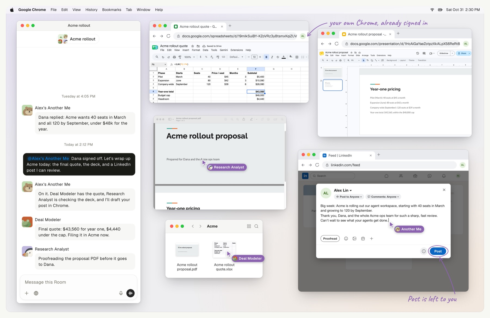

<h1 align="center">PolyStrata</h1>

[English](README.md) · [简体中文](README.zh-CN.md) · [日本語](README.ja.md) · [Deutsch](README.de.md) · **Français** · [Español](README.es.md) · [Português](README.pt-BR.md) · [Türkçe](README.tr.md)

<p align="center"><b>Faites tourner de grands modèles d'IA sur votre propre PC</b><br>
Qwen3.8-Flash-Next, Hy4-Flash, GLM 5.3 Flash, DeepSeek V4 Flash, LFM2.5, Flint, Qwen3.6, Clover, Ornith 1.5, Gemma 4, Tiel Coder, MiniCPM-V et Kolibri 1 · gratuit et open source</p>

<p align="center"><a href="https://github.com/simplexai-labs/linger"></a></p>

<p align="center"></p>

<p align="center"><br>
<sub>Claude Code avec Qwen3.6-35B-A3B UD-Q3_K_M sur le portable à carte de 8 Go, en temps réel : il ajoute une option <code>--json</code> à un petit programme, écrit un test et lance les tests. Le serveur avait lu le prompt système de Claude Code à son démarrage (<code>"warm_start": true</code>).</sub></p>

<p align="center"><br>
<sub><a href="https://github.com/simplexai-labs/linger">Linger</a> sur PolyStrata : Inkling 2 Mini UD-Q3_K_XL, sur le portable à carte 8 Go, à environ 33 tokens par seconde, écrit un village low-poly dans un seul fichier three.js, et Linger l'ouvre.</sub></p>

PolyStrata fait tourner de grands modèles d'IA sur un PC normal, des modèles qui demandent d'habitude un serveur.
Ils discutent, écrivent du code et fonctionnent avec vos applications et vos agents de code. Rien ne quitte votre PC.

Il fait tourner quatorze modèles, avec deux moteurs :

- **[Qwen3.8-Flash-Next](https://huggingface.co/Qwen/Qwen3.8-Flash-Next)** sur une carte graphique NVIDIA ou AMD
  de 12 Go ou plus, sous Windows ou Linux. Il lit aussi les images. Son moteur est celui de
  [Strata](https://github.com/Niko1221/Strata), inchangé.

Les treize autres tournent sur un moteur écrit pour PolyStrata, avec une carte NVIDIA ou [deux](docs/MULTI_GPU.md#the-strata-poly-models) : tous les treize sous Linux, et
tous sauf GLM 5.3 Flash et DeepSeek V4 Flash aussi sous Windows. Ils sont expérimentaux : ils n'ont tourné que sur un seul PC avec une carte
de 32 Go, neuf des plus petits en plus sur un portable avec une carte de 8 Go, et Groot sur un PC avec une RTX 5060 de 8 Go.

- **[GLM 5.3 Flash](docs/models/glm.fr.md)**, le plus grand : un fichier de 79 à 114 Go, dont la plus grande part reste en RAM.
- **[DeepSeek V4 Flash](docs/models/deepseek.fr.md)**, un fichier de 91 Go, dont la plus grande part reste aussi en RAM. Sa
  mémoire d'une discussion est petite : un contexte de 128K ne prend que 0,7 Go de VRAM de plus que 32K.
- **[LFM2.5-24B-A2B](docs/models/lfm25.fr.md)** de Liquid AI, un fichier de 11 à 25 Go. La plupart de ses couches n'ont pas
  d'attention, si bien qu'une longue discussion prend peu de VRAM : un contexte de 128K ne prend que 2 Go de plus
  que 32K. Sa licence n'autorise l'usage commercial qu'aux entreprises de moins de 10 millions de dollars de chiffre
  d'affaires annuel.
- **[Flint 40B-A2.5B](docs/models/flint.fr.md)** de Recursive, fait pour les agents de code : un fichier de 18 à 42 Go. La
  plupart de ses couches ne regardent que 513 tokens en arrière, si bien qu'une longue discussion prend peu de VRAM :
  un contexte de 128K ne prend que 2,6 Go de plus que 32K.
- **[Qwen3.6-35B-A3B](docs/models/qwen36.fr.md)**, un fichier de 13 à 23 Go. Il lit aussi les images.
- **[Groot 19B-A3B 261023](docs/models/groot.md)**, intégration expérimentale dans l'installeur pour trois quantifications de
  Bartowski, Q4_K_M, Q6_K et Q8_0 (12,5 à 20,2 Go), avec MTP et un projecteur d'images en option. Q4_K_M a tourné en
  texte sur une RTX 5060 de 8 Go et sur une RTX 5090 sous Linux ; les images, Q6_K et Q8_0 restent à vérifier.
- **[Inkling 2 Mini](docs/models/inkling.md)** de Thinking Machines, expérimental : un fichier de 9 à 18 Go. Il a tourné
  sous Linux avec une carte NVIDIA de 32 Go et sous Windows avec une carte de portable de 8 Go. Il lit aussi les images, une requête à la fois.
- **[Clover-35B-A3B-Preview](docs/models/clover.fr.md)** de DiffuSpace, Qwen3.6-35B-A3B entraîné plus loin pour écrire
  aussi un bloc de tokens d'un coup : un fichier de 13 à 21 Go. Il ne lit que du texte.
- **[Ornith 1.5](docs/models/ornith.fr.md)**, qui a l'architecture de Qwen3.6-35B-A3B et d'autres poids : un fichier de 14 à 24 Go.
  Il lit aussi les images.
- **[Gemma 4 26B-A4B](docs/models/gemma4.fr.md)**, un fichier de 11 à 17 Go. Il lit aussi les images.
- **[Tiel Coder 35B-A3B](docs/models/tiel.fr.md)**, Ornith 1.5 quantifié par peculiar-ragdoll pour les agents de code :
  un fichier de 14 à 23 Go. Il lit aussi les images.
- **[MiniCPM-V 4.7 35B-A3B](docs/models/minicpmv.fr.md)** d'OpenBMB, avec l'architecture de Qwen3.6-35B-A3B et ses propres
  poids, fait pour lire les images : un fichier de 16 à 29 Go.
- **[Kolibri 1](docs/models/kolibri.fr.md)** d'Aleph Alpha, qui écrit l'allemand aussi bien que l'anglais : un fichier
  de 29 à 48 Go, qui reste surtout en RAM à côté d'une petite carte.
- **[Hy4-Flash](https://github.com/Niko1221/Strata/releases/tag/v0.2.18)** de Tencent, 220B-A12B, sur le moteur propre au projet Strata (`strata-hy4`) : un fichier de 130 à
  181 Go, à partir de 64 Go de RAM avec une carte de 8 Go. Il lit aussi les images.

Le serveur peut passer d'un modèle installé à un autre pendant qu'il tourne
([comment](docs/BACKENDS.md#changing-the-model), en anglais).

PolyStrata a été créé par [VecSzn](https://github.com/VecSzn).
PolyStrata est construit sur [Strata](https://github.com/Niko1221/Strata) de Niko1221.
Pourquoi c'est un dépôt à part, les cartes AMD et plus petites, les fine-tunes et d'autres questions : [FAQ](docs/FAQ.md) (en anglais).

## Quelle est sa vitesse ?

Un token correspond à environ ¾ d'un mot.

- **Écrit les réponses :** la vitesse à laquelle la réponse s'affiche dans une courte discussion. 60 tokens par seconde, c'est plus rapide que votre lecture.
- **Lit votre prompt :** la vitesse à laquelle il absorbe ce que vous envoyez (ici un document, du code ou un historique de discussion de 32K tokens).

Le tableau donne la taille que l'installeur prend pour chaque modèle, en tokens par seconde. Les chiffres de chaque taille, la comparaison avec llama.cpp et la façon de mesurer sont sur la page de chaque modèle.

| Modèle | Portable avec une carte de 8 Go<br>écrit / lit | RTX 5090<br>écrit / lit | Toutes les tailles |
| --- | ---: | ---: | --- |
| LFM2.5-24B-A2B | 86 / 4,035 | 492 / 25,275 | [LFM2.5](docs/models/lfm25.fr.md) |
| Flint 40B-A2.5B | 64 / 2,643 | 261 / 15,033 | [Flint](docs/models/flint.fr.md) |
| Qwen3.6-35B-A3B | 106 / 2,483 | 536 / 15,319 | [Qwen3.6](docs/models/qwen36.fr.md) |
| Clover-35B-A3B-Preview | 83 / 2,242 | 308 / 13,918 | [Clover](docs/models/clover.fr.md) |
| Ornith 1.5 | 87 / 2,362 | 366 / 14,438 | [Ornith](docs/models/ornith.fr.md) |
| Gemma 4 26B-A4B | 92 / 2,187 | 370 / 11,478 | [Gemma 4](docs/models/gemma4.fr.md) |
| Tiel Coder 35B-A3B | 89 / 2,517 | 440 / 15,109 | [Tiel Coder](docs/models/tiel.fr.md) |
| MiniCPM-V 4.7 35B-A3B | 79 / 2,263 | 331 / 14,615 | [MiniCPM-V](docs/models/minicpmv.fr.md) |
| Kolibri 1 | 66 / 851 | 207 / 6,133 | [Kolibri 1](docs/models/kolibri.fr.md) |
| GLM 5.3 Flash | ne tourne pas : il faut une carte de 32 Go | 52 / 863 | [GLM](docs/models/glm.fr.md) |
| DeepSeek V4 Flash | ne tourne pas : il faut une carte de 32 Go | 54 / 1,926 | [DeepSeek](docs/models/deepseek.fr.md) |
| Inkling 2 Mini | 53 / 892 | 196 / 6,706 | [Inkling 2 Mini](docs/models/inkling.md) |
| Groot 19B-A3B 261023 | 97 / 2,785 | 458 / 15,634 | [Groot](docs/models/groot.md) |
| Hy4-Flash | ne tourne pas : il faut 64 Go de RAM | 90-111 / 1,694 | [Hy4-Flash](https://github.com/Niko1221/Strata/releases/tag/v0.2.18) |

Portable : RTX 4070 Laptop (8 Go), Core i7-14700HX, 32 Go de RAM. Station de travail : RTX 5090 (32 Go), Xeon Platinum 8470Q (25 vCPU), 90 à 120 Go de RAM. Flint est en UD-Q3_K_XL sur le portable, la taille que l'installeur prend avec 32 Go de RAM, et en UD-Q4_K_XL sur la station de travail. Kolibri 1 est en Q2_K sur les deux ; sur la station de travail, l'installeur prend Q4_K_M, qui n'a pas été mesuré.

Qwen3.8-Flash-Next et Hy4-Flash tournent sur les moteurs du projet [Strata](https://github.com/Niko1221/Strata), qui les a mesurés. Qwen3.8-Flash-Next sur un PC avec une RTX 5070 (12 Go) et 64 Go de RAM : IQ2_XS écrit à 79 et lit un prompt de 32K à 2,090 ([toutes les tailles](docs/models/qwen38.fr.md)). Hy4-Flash sur une RTX 5090 : écrit entre 90 et 111 et lit un prompt de 128K à 1,694 ([sa version](https://github.com/Niko1221/Strata/releases/tag/v0.2.18)).

Les onze modèles du moteur propre à PolyStrata ont été mesurés avec son benchmark, que vous pouvez lancer sur votre
PC : `python polystrata.py benchmark --model <name> --prompt-tokens 24000`
([ce qu'il envoie et affiche](docs/BACKENDS.md#benchmark), en anglais).
Ce que d'autres ont mesuré sur leurs cartes, et comment comparer avec llama.cpp sur la vôtre :
[résultats de la communauté](docs/COMMUNITY_BENCHMARKS.md#the-models-polystrata-adds) (en anglais).
Sur le portable, PolyStrata a lu les prompts 2.7 à 3.5 fois plus vite que llama.cpp b11540 et écrit 1.5 à 1.8
fois plus vite, avec Qwen3.6 et avec Tiel Coder ([les deux mesures](docs/COMMUNITY_BENCHMARKS.md#comparing-with-llamacpp), en anglais).

## Combien de RAM il occupe

Depuis 0.1.45-poly.7, le moteur des treize modèles occupe moins de RAM : il ne garde plus en mémoire les parties du
fichier du modèle déjà placées sur la carte graphique. Sur le portable, après un prompt de 32,000 tokens,
Qwen3.6-35B-A3B occupait 17.9 GiB avec 0.1.45-poly.6 et en occupe 13.1 maintenant, en écrivant aussi vite. Sous
Linux, de 17.8 à 12.6 GiB.

Pour en occuper moins, ajoutez `"--ram-experts-mib", "6144"` à la liste `"args"` de `strata-<model>.json`
([où](docs/INSTALL.md#where-things-are-stored)) et redémarrez. Le moteur garde alors ce nombre de MiB de RAM pour les
experts qui restent hors de la VRAM, aussi pendant qu'il répond, et l'indique au démarrage. Les autres restent dans le
cache de fichiers du système, où vos autres programmes peuvent prendre cette mémoire, et sont lus de là quand un token
en a besoin. Quand les experts tiennent dans la RAM libre, c'est désactivé par défaut parce que cela écrit moins vite,
et nous continuons d'y travailler ; quand ils n'y tiennent pas, le moteur l'active de lui-même (plus bas). Sur le
portable (RTX 4070 Laptop 8 Go, 32 Go de RAM, Windows 11), Qwen3.6-35B-A3B UD-Q3_K_M :

| | par défaut | `--ram-experts-mib 6144` |
| --- | ---: | ---: |
| RAM occupée par le moteur après le chargement | 11.7 GiB | **6.5 GiB** |
| au plus pendant l'écriture : chat court / après un prompt de 32K | 14.3 / 14.0 GiB | **6.7 / 7.3 GiB** |
| entre deux requêtes | 12.8 GiB | **7.1 GiB** |
| Écrit, tokens/s : le premier chat court | 71.6 | 69.4 (3 % plus lent) |
| après le prompt de 32K | 65.4 | 63.7 (3 % plus lent) |
| un chat court ensuite | 84.2 | 72.9 (13 % plus lent) |
| une longue réponse (1,024 tokens d'un chat court) | 90.6 | 78.3 (14 % plus lent) |

Pendant cette mesure d'autres programmes occupaient une partie de la VRAM, donc les deux colonnes écrivent moins vite
qu'avec la carte libre. Sur deux autres mesures, il écrivait 6 à 8 % moins vite après le prompt de 32K et 8 à 10 %
dans le chat suivant. Sous Linux (une RTX PRO 6000 limitée à environ 8 Go) il occupait 7.0 à 7.7 GiB au lieu de 12.3 à
14.3 et écrivait 7 à 14 % moins vite. Avec le cache d'experts figé, comme on vérifie une version, les réponses sont
identiques token par token.

Quand les experts hors de la VRAM ne tiennent pas dans la RAM libre, le moteur garde maintenant les plus utilisés dans
un budget égal à cette RAM moins 4 GiB et lit les autres sur le SSD quand un token en a besoin ; il l'indique au
démarrage. Avant, il les mappait tous et le système les relisait défaut de page après défaut de page. La limite de
mémoire d'un conteneur compte aussi. Mesuré sous Linux sur une RTX PRO 6000 limitée à environ 8 Go, le moteur limité à
12 Go puis à 10 Go de RAM, ce qu'il lui reste sur un PC de 16 Go, et le fichier du modèle hors du cache de fichiers à
chaque démarrage : Qwen3.6-35B-A3B UD-Q3_K_M, tokens/s dans le premier chat court, après un prompt de 24,000 tokens et
dans un chat court ensuite.

| RAM pour le moteur | tous les experts mappés (avant) | le budget qu'il prend maintenant |
| --- | ---: | ---: |
| 12 Go | 51 / 75-78 / 94-98 | **57-60 / 77-85 / 131-139** |
| 10 Go | 39 / 48 / 69 | **51 / 64 / 92** |

Sans limite, la même machine écrit 63 / 169 / 203. Ce n'est pas mesuré sous Windows, où le même code tourne.
`"--ram-experts-mib", "-1"` garde tous les experts mappés comme avant.

À l'inverse, `"--lock-experts"` garde en RAM les experts hors de la VRAM : le système ne peut pas donner cette
mémoire à d'autres programmes, et le moteur n'a pas à les relire depuis le SSD. Avec une seule carte NVIDIA, le
moteur les copie au chargement dans de la mémoire épinglée, que le système ne pagine pas et que `ulimit -l` ne limite
pas ; un expert qui quitte la VRAM plus tard y est copié depuis le fichier du modèle entre deux requêtes. Là où il ne
fait pas cette copie (carte AMD, Mac, couches réparties sur plusieurs cartes, trop peu de RAM libre), il verrouille à
la place les pages du fichier du modèle ; sous Linux cela s'arrête à `ulimit -l`, et la ligne de démarrage du moteur
donne la limite et la façon de la relever.

Le moteur demande aussi 350 à 400 MiB de VRAM de moins pour lire les prompts : le cache d'experts les prend (Qwen3.6
garde 2,712 experts en VRAM au lieu de 2,444), ou `--vram-reserve-mib` les laisse aux autres programmes.
Comment c'est mesuré : [docs/BACKENDS.md](docs/BACKENDS.md#less-of-the-pcs-ram-and-vram).

## Ce qu'il vous faut

| Modèle | Carte graphique | RAM (taille de l'installeur) | Disque | Système |
| --- | --- | --- | --- | --- |
| [Qwen3.8-Flash-Next](docs/models/qwen38.fr.md) | NVIDIA RTX série 20 à 50, ou AMD RX 6800 / 6900, RX 7700 XT / 7800 XT / 7900 XT / XTX, RX 9060 XT / 9070 / 9070 XT, Radeon AI PRO R9700 ; 12 Go ou plus | 32 Go ou plus ; avec 64 Go, toutes les tailles | environ 80 Go | Windows, Linux |
| [GLM 5.3 Flash](docs/models/glm.fr.md) | NVIDIA RTX série 20 ou plus récente ; seulement essayé sur une carte de 32 Go | 96 Go à côté d'une carte de 32 Go | 79 à 114 Go, sur un SSD | Linux |
| [DeepSeek V4 Flash](docs/models/deepseek.fr.md) | comme au-dessus | 72 Go à côté d'une carte de 32 Go | 91 Go, sur un SSD | Linux |
| [LFM2.5-24B-A2B](docs/models/lfm25.fr.md) | NVIDIA RTX série 20 ou plus récente, 8 Go ou plus | environ 20 Go à côté d'une carte de 8 Go | 11 à 25 Go | Windows, Linux, Mac (bêta) |
| [Flint 40B-A2.5B](docs/models/flint.fr.md) | comme au-dessus | environ 22 Go à côté d'une carte de 8 Go | 18 à 42 Go | Windows, Linux |
| [Qwen3.6-35B-A3B](docs/models/qwen36.fr.md) | comme au-dessus ; AMD en bêta | environ 21 Go à côté d'une carte de 8 Go | 13 à 23 Go | Windows, Linux, Mac (bêta) |
| [Clover-35B-A3B-Preview](docs/models/clover.fr.md) | NVIDIA RTX série 20 ou plus récente, 8 Go ou plus | environ 20 Go à côté d'une carte de 8 Go | 13 à 21 Go | Windows, Linux |
| [Ornith 1.5](docs/models/ornith.fr.md) | comme au-dessus ; AMD en bêta | environ 22 Go à côté d'une carte de 8 Go | 14 à 24 Go | Windows, Linux |
| [Gemma 4 26B-A4B](docs/models/gemma4.fr.md) | comme au-dessus ; AMD en bêta | environ 18 Go à côté d'une carte de 8 Go | 11 à 17 Go | Windows, Linux |
| [Tiel Coder 35B-A3B](docs/models/tiel.fr.md) | comme au-dessus ; AMD en bêta | environ 21 Go à côté d'une carte de 8 Go | 14 à 23 Go | Windows, Linux |
| [MiniCPM-V 4.7 35B-A3B](docs/models/minicpmv.fr.md) | comme au-dessus ; AMD en bêta | environ 25 Go à côté d'une carte de 8 Go | 16 à 29 Go | Windows, Linux |
| [Kolibri 1](docs/models/kolibri.fr.md) | NVIDIA RTX série 20 ou plus récente, 8 Go ou plus | environ 33 Go à côté d'une carte de 8 Go | 29 à 48 Go | Windows, Linux |
| [Groot 19B-A3B 261023](docs/models/groot.md) (expérimental) | backends CUDA/HIP partagés ; Q4_K_M en texte sur une RTX 5060 de 8 Go (pic mesuré 7,05 Gio de VRAM, 21,8 Gio de RAM) | environ 17 Go à côté d'une carte de 8 Go pour Q4_K_M, estimation de l'installeur | 12,5 à 20,2 Go ; les images ajoutent 0,9 Go | Windows, Linux ; images, Q6_K et Q8_0 non testés |
| [Inkling 2 Mini](docs/models/inkling.md) (expérimental) | NVIDIA, 8 Go ou plus ; a tourné sur une RTX 5090 et une RTX 4070 Laptop (8 Go, UD-Q3_K_XL) | environ 21 Go à côté d'une carte de 8 Go pour UD-Q4_K_XL, estimation de l'installeur | 9 à 18 Go | Windows, Linux, Mac (bêta) |
| [Hy4-Flash](https://github.com/Niko1221/Strata/releases/tag/v0.2.18) (moteur du projet Strata) | NVIDIA V100 à RTX 50, 8 Go ou plus ; AMD RX 6000 à 9000 et Strix Halo ; Intel Arc | 64 Go ou plus pour SQ-64, 96 Go pour SQ-96, 128 Go pour SQ-128 | 130 à 181 Go, sur un SSD | Windows, Linux, Mac |

La RAM est l'estimation de l'installeur ; une carte plus grande en demande moins. L'installeur s'occupe de tout le reste : sous Windows, il télécharge le moteur déjà compilé et ne le compile sur votre PC que sur un processeur sans AVX2, pour les modèles propres à PolyStrata sur une carte AMD, ou si le moteur de votre copie est plus récent que la dernière version, en proposant d'installer les outils qui manquent. Deux ou trois cartes peuvent se partager un modèle ([multi-GPU](docs/MULTI_GPU.md)). Cartes graphiques plus anciennes, Intel Arc, Mac Apple Silicon (Qwen3.8-Flash-Next, et Qwen3.6, LFM2.5 et Inkling 2 Mini en bêta), Strix Halo et processeurs sans AVX2 : [la liste complète](docs/INSTALL.md#what-you-need). La carte, la RAM et les tailles de chaque modèle en détail sont sur sa page.

Ce qu'il faut à chacun des six (Qwen3.6, Clover, Ornith 1.5, Gemma 4, Tiel Coder et MiniCPM-V) et comment il a été vérifié : [docs/BACKENDS.md](docs/BACKENDS.md#install) (en anglais).

## Installation

### Laissez votre IA l'installer

Vous utilisez un assistant de code IA (Claude Code, Cursor, Codex, GitHub Copilot, ...) ? Collez-lui ceci :

```text
Set up PolyStrata on this PC for me: https://github.com/simplexai-labs/PolyStrata - follow docs/AI_SETUP.md in that repository.
```

Il vérifie votre carte graphique, votre RAM et votre disque, et choisit le modèle qui convient. Ensuite il l'installe,
le démarre et vous explique comment connecter vos applications. Les outils d'IA peuvent aussi installer, démarrer et
arrêter PolyStrata grâce à son [serveur MCP](docs/MCP_SERVER.md).

### Ou faites-le vous-même

[Téléchargez PolyStrata](https://github.com/simplexai-labs/PolyStrata/archive/refs/heads/main.zip) et décompressez-le (ou faites un `git clone`).
**Windows :** double-cliquez sur **`START-HERE.bat`**. **Linux :** lancez **`./setup.sh`** dans le dossier PolyStrata.

**Mac (Apple Silicon, M1 à M5, macOS 15 ou plus récent) :** installez une fois les Command Line Tools d'Apple (`xcode-select --install` dans le Terminal ; Xcode lui-même n'est pas nécessaire). Ouvrez ensuite le Terminal dans le dossier PolyStrata et lancez **`./setup.sh`**. Il compile le moteur Mac sur votre Mac (environ 7 minutes), pose les mêmes questions, télécharge le modèle et le démarre. La fois suivante, `./setup.sh` démarre tout de suite. Quelle taille convient à votre Mac et sa vitesse : [docs/MAC.md](docs/MAC.md). Par défaut, il installe Qwen3.8-Flash-Next. `./setup.sh --family qwen36` ou `--family lfm25` installe à la place Qwen3.6 ou LFM2.5 sur le moteur Metal de strata-poly, en bêta : sur un M5 Ultra, Qwen3.6 UD-Q2_K_XL a écrit 134 tokens/s dans une courte conversation et lu un prompt de 3,768 tokens à 2,978 tokens/s. `--family inkling` installe Inkling 2 Mini de la même façon : sur le M5 Ultra, UD-Q3_K_XL a écrit 74 tokens/s dans une courte conversation, lu un prompt de 32,787 tokens à 2,440 tokens/s et écrit 61 tokens/s ensuite ; il lit les images sur le CPU. Le setup propose aussi GLM, DeepSeek, Ornith, Gemma 4, Tiel Coder et MiniCPM-V sur un Mac, mais ils n'y ont pas encore tourné avec leurs vrais poids. Kolibri, Flint et Clover ont besoin d'une carte NVIDIA ou AMD.

Les étapes sont les mêmes pour NVIDIA et AMD. L'installateur détecte votre carte et installe le bon moteur pour elle.
Il vous pose quelques questions :

- quel modèle et quelle taille,
- combien de contexte (la quantité de texte que le modèle garde en tête),
- s'il doit lire les images (GLM 5.3 Flash, DeepSeek V4 Flash, LFM2.5, Flint, Clover et Kolibri 1 n'en lisent pas).

Appuyez sur Entrée à chaque fois pour garder la réponse recommandée. Ensuite il télécharge le modèle (environ 70 Go pour
Qwen3.8-Flash-Next, 79 à 114 Go pour GLM 5.3 Flash, 91 Go pour DeepSeek V4 Flash, 29 à 48 Go pour Kolibri 1, 11 à 42 Go pour les huit autres)
et le démarre. Si le téléchargement s'arrête, relancez-le : il reprend là où il s'était arrêté. Quand le modèle est
prêt, son API est à l'adresse `http://127.0.0.1:8080/v1`. Si vous voulez une application pour discuter avec lui, nous
recommandons [Linger](https://github.com/simplexai-labs/linger). Toute application compatible avec l'API d'OpenAI ou d'Anthropic marche aussi.

Les quatorze figurent dans la liste des modèles de l'installeur. `./setup.sh --family glm`, `deepseek`, `lfm25`, `flint`, `qwen36`, `clover`,
`ornith`, `gemma4`, `tiel`, `minicpmv`, `kolibri`, `groot` ou `inkling` mène directement à l'un d'eux ([ce qu'il demande et écrit](docs/GLM.md#install), en anglais).

> **Pendant le démarrage du modèle, votre PC peut ralentir ou ne plus répondre pendant 1-3 minutes** (plus longtemps la première fois).
> PolyStrata charge 35-55 Go dans votre RAM et en réserve une partie pour la carte graphique. C'est normal. Attendez, et
> ne fermez pas la fenêtre. La fenêtre montre ce que fait PolyStrata.

**La fois suivante**, relancez `START-HERE.bat` (ou `./setup.sh`). Il démarre tout de suite et ne télécharge rien
deux fois. Fermez sa fenêtre pour arrêter le modèle. `UPDATE.bat` (`./setup.sh --update`) met PolyStrata à jour sans le démarrer.
Depuis 0.1.45-poly.10 ou plus ancien : les fichiers de setup sont maintenant dans `terminal/` ([quoi changer](docs/INSTALL.md#coming-from-0145-poly10-or-older)).
Mises à jour, plusieurs cartes, emplacement des fichiers et toutes les options : [docs/INSTALL.md](docs/INSTALL.md).

**C'est rapide sur votre PC ?** Lancez `tools/BENCH.bat` (`tools/bench.sh`) : 5 à 10 minutes environ ; il mesure le chat, des prompts de 4K/16K et une session de type agent avec vos propres réglages, et écrit un rapport à partager ([comment](docs/COMMUNITY_BENCHMARKS.md#run-the-benchmark)).

## Quel modèle choisir ?

Le même modèle existe en plusieurs tailles, plus ou moins compressées : les petites sont plus rapides et demandent moins de RAM, les grandes sont plus proches de l'original. L'installeur en prend une pour votre RAM et votre carte si vous appuyez sur Entrée ; pour une autre taille, ajoutez `--model <taille>` à l'installation.

| Modèle | L'installeur prend | Avec moins de RAM | Seulement par son nom |
| --- | --- | --- | --- |
| [Qwen3.8-Flash-Next](docs/models/qwen38.fr.md) | 32 Go de RAM : Coder ; 48 à 64 Go : IQ2_XS ; 96 Go ou plus : IQ3_S |  | Q2_0, IQ3_XXS, les fichiers 4 à 8 bits d'Unsloth |
| [GLM 5.3 Flash](docs/models/glm.fr.md) | 3.0BIT | UD-IQ2_XXS, puis REAP50-Q3_K_M |  |
| [DeepSeek V4 Flash](docs/models/deepseek.fr.md) | UD-IQ2_XXS (la seule taille) |  |  |
| [LFM2.5-24B-A2B](docs/models/lfm25.fr.md) | UD-Q4_K_XL | UD-Q3_K_XL | QAD-Q4_0, UD-Q6_K_XL, Q8_0 |
| [Flint 40B-A2.5B](docs/models/flint.fr.md) | UD-Q4_K_XL à partir d'environ 40 Go de RAM | UD-Q3_K_XL | UD-Q6_K_XL, Q8_0 |
| [Qwen3.6-35B-A3B](docs/models/qwen36.fr.md) | UD-Q3_K_M | UD-Q2_K_XL | UD-Q4_K_M |
| [Clover-35B-A3B-Preview](docs/models/clover.fr.md) | Q3_K_M | APEX-I-NANOPLUS | Q4_K_M |
| [Ornith 1.5](docs/models/ornith.fr.md) | APEX-I-COMPACT | APEX-I-MINI | APEX-I-QUALITY |
| [Gemma 4 26B-A4B](docs/models/gemma4.fr.md) | UD-Q3_K_M | UD-Q2_K_XL | UD-Q4_K_M, QAT-UD-Q4_K_XL |
| [Tiel Coder 35B-A3B](docs/models/tiel.fr.md) | UD-Q3_K_XL | UD-IQ3_XXS | UD-Q4_K_XL |
| [MiniCPM-V 4.7 35B-A3B](docs/models/minicpmv.fr.md) | Q4_K_M | mix_q3gud_im | Q6_K |
| [Kolibri 1](docs/models/kolibri.fr.md) | Q4_K_M à partir d'environ 48 Go de RAM | Q2_K | Q3_K_M |
| [Groot 19B-A3B 261023](docs/models/groot.md) | Q4_K_M | — | Q6_K, Q8_0 |
| [Inkling 2 Mini](docs/models/inkling.md) | UD-Q4_K_XL | UD-Q3_K_XL | UD-Q2_K_XL |
| [Hy4-Flash](https://github.com/Niko1221/Strata/releases/tag/v0.2.18) | SQ-64 dès 64 Go de RAM, SQ-96 dès 96 Go, SQ-128 dès 128 Go |  |  |

Ce qu'est chaque taille, son téléchargement, la RAM qu'elle demande à côté d'autres cartes et à quel point elle se rapproche de la plus grande : la page de chaque modèle, liée depuis le tableau de « Quelle est sa vitesse ? ».

## Utilisation

Les quatorze modèles s'utilisent de la même façon, avec la même API.

<p align="center"><a href="https://github.com/simplexai-labs/linger"></a><br>
<sub><a href="https://github.com/simplexai-labs/linger">Linger</a> : plusieurs agents se partagent un ordinateur et le navigateur où vous êtes déjà connecté. Une image du projet Linger.</sub></p>

- **Comme agent personnel :** nous recommandons [Linger](https://github.com/simplexai-labs/linger). Téléchargez-le pour Mac (Apple Silicon), Windows ou
  Linux depuis [sa dernière version](https://github.com/simplexai-labs/linger/releases/latest).
- **Dans un terminal :** `python polystrata.py --model <name>` dans le dossier PolyStrata ouvre une discussion avec un
  modèle installé, et `--list-models` les liste ([plus](docs/INSTALL.md#the-terminal)).
- **Dans le navigateur :** `http://127.0.0.1:8080` affiche un **Monitor** en direct du
  modèle et de votre GPU/CPU/RAM, **Requests**, qui ouvre le [moniteur des requêtes de l'API](docs/DETAILS.md#api-request-monitor)
  dans un onglet à part une fois activé, et **About** avec les réglages et les adresses. Avec plusieurs modèles installés,
  la liste en haut de la page passe de l'un à l'autre.
- **Vos applications et agents de code :** ajoutez un fournisseur « OpenAI-compatible » avec l'URL de base
  **`http://127.0.0.1:8080/v1`**. N'importe quelle clé API et n'importe quel nom de modèle fonctionnent.
  - Applications qui utilisent l'API d'Anthropic : `http://127.0.0.1:8080/v1/messages` (Claude Code :
    `ANTHROPIC_BASE_URL=http://127.0.0.1:8080`, et `"anthropic_thinking": "on_request"` dans `strata-<model>.json`
    ([pourquoi](docs/FAQ.md#can-i-use-it-with-claude-code-codex-or-other-apps))).
  - Codex CLI et les autres applications qui utilisent l'API OpenAI Responses : `/v1/responses`
    ([configuration](docs/DETAILS.md#the-responses-api-and-codex-cli)).
- **Réflexion :** choisissez **off, low, medium ou high** dans le réglage « reasoning effort » de
  votre application. Off est le plus rapide. High est le meilleur pour les questions difficiles.
- **Depuis votre téléphone ou un autre PC :** `START-HERE.bat --setup --host 0.0.0.0 --api-key <secret>`. Définissez
  toujours une clé.

Là où ils diffèrent :

| | Qwen3.8-Flash-Next | GLM 5.3 Flash | DeepSeek V4 Flash | LFM2.5-24B-A2B | Flint 40B-A2.5B | Kolibri 1 | Qwen3.6-35B-A3B, Clover-35B-A3B-Preview, Ornith 1.5, Gemma 4 26B-A4B, Tiel Coder 35B-A3B, MiniCPM-V 4.7 35B-A3B |
| --- | --- | --- | --- | --- | --- | --- | --- |
| **Images** | Répondez oui à « Images? » pendant l'installation. Ensuite joignez des images dans votre application. Avec moins de 24 Go de mémoire graphique, l'encodeur d'images tourne sur le processeur, chez NVIDIA comme chez AMD. | Pas encore. | Il ne lit que du texte. | Il ne lit que du texte. | Il ne lit que du texte. | Il ne lit que du texte. | Répondez oui à « Images? » pendant l'installation, puis comme avec Qwen3.8-Flash-Next. Sur une carte de moins de 16 Go, l'encodeur d'images tourne sur le processeur, et une image prend quelques secondes. Clover ne lit que du texte. |
| **Une requête à la fois** | Par défaut, PolyStrata répond à une requête et les autres attendent. Pour répondre à plusieurs en même temps, mettez `"parallel": 2` ([BATCHING.md](docs/BATCHING.md)). Sur une carte de 12 Go, chaque réponse devient alors plus lente. | Une à la fois, les autres attendent. | Une à la fois, les autres attendent. | Une à la fois, les autres attendent. | Une à la fois, les autres attendent. | Une à la fois, les autres attendent. | Une à la fois, les autres attendent. |
| **Plusieurs discussions** | Par défaut, plusieurs restent en RAM tant qu'il y a la place, donc les messages suivants et les agents qui se relaient démarrent en quelques secondes ([détails](docs/DETAILS.md#conversation-cache)). | La dernière est conservée. L'installation demande s'il faut en garder plusieurs en RAM, pour qu'un agent et ses sous-agents se relaient sans que leurs prompts soient relus ([comment](docs/GLM.md#several-conversations-at-once)). | Comme GLM 5.3 Flash. | Comme GLM 5.3 Flash. | Comme GLM 5.3 Flash. | Comme GLM 5.3 Flash. | Comme GLM 5.3 Flash. |
| **Longs prompts** | PolyStrata lit en entier le premier message d'une discussion, environ 1 minute pour 30,000 tokens. Les messages suivants démarrent en quelques secondes. | Le premier message est lu en entier, environ 40 secondes pour 30,000 tokens. | Le premier message est lu en entier, environ 29 secondes pour 30,000 tokens. | Le premier message est lu en entier : 30,000 tokens prennent 1,3 à 1,5 seconde sur la station de travail et 8 à 10 secondes sur le portable de 8 Go. | Le premier message est lu en entier : 30,000 tokens prennent environ 2,3 secondes sur la station de travail et 15 à 22 secondes sur le portable de 8 Go. | Le premier message est lu en entier : 30,000 tokens prennent avec Q2_K environ 6 secondes sur la station de travail et environ 40 secondes sur le portable de 8 Go. | Le premier message est lu en entier : 30,000 tokens prennent 4 à 5 secondes sur la station de travail et 14 à 27 secondes sur le portable de 8 Go. |

Plus d'infos : [où sont stockés les fichiers](docs/INSTALL.md#where-things-are-stored), [l'API](docs/DETAILS.md#using-it).

### Optionnel : plus de vitesse sur une seule carte quand tout le modèle tient en RAM

Deux réglages optionnels (de RubenTorney, #1904 et #1905). Ils aident si vous utilisez une seule carte graphique et que votre RAM contient tous les experts (le mode arena de PolyStrata, par exemple Q2_0 ou IQ3_XXS sur un PC de 64 Go). Ouvrez votre configuration `strata-<model>.json` dans le dossier `terminal` de PolyStrata ([où](docs/INSTALL.md#where-things-are-stored)) et ajoutez :

- **Génération plus rapide :** `"--adapt-async", "1"` dans la liste `"args"`. Le cache d'experts est alors mis à jour dans un thread auxiliaire au lieu de mettre la réponse en pause. Mesuré sur une RTX 5070 (Windows, Q2_0) : +4-5 % de génération, +7-10 % sur le code et les longs documents. Les réponses peuvent légèrement différer de celles par défaut (elles restent identiques d'une exécution à l'autre).
- **Lecture du prompt plus rapide sous Windows :** `"STRATA_PIN_BY_NEED": "1"` dans le bloc `"env"`. Windows ne peut verrouiller qu'environ la moitié de la RAM pour la carte ; ce réglage verrouille d'abord les experts dont la carte a vraiment besoin. Mesuré sur la RTX 5070 : +4,4 % en lecture du prompt.

```json
"args": [ ..., "--adapt-async", "1" ],
"env": { "STRATA_PIN_BY_NEED": "1" }
```

Redémarrez PolyStrata (`START-HERE.bat` ou `./setup.sh`) après la modification. Pour annuler, retirez les deux entrées.

## Un problème ?

- **Mon PC s'est figé au premier démarrage de PolyStrata.** C'est normal pendant le chargement du modèle. Attendez, et ne
  fermez pas la fenêtre. Toujours figé après 10 minutes ? Redémarrez le PC, fermez les autres programmes et
  réessayez, ou choisissez une taille plus petite.
- **Il s'est arrêté pendant le téléchargement ou l'installation.** Relancez `START-HERE.bat` (ou `./setup.sh`). Il
  reprend là où il s'était arrêté.
- **C'est très lent et le voyant du disque clignote sans arrêt, ou il affiche « the engine stopped unexpectedly ».**
  Votre PC n'a pas assez de RAM libre. Fermez les autres programmes (les navigateurs en utilisent beaucoup), ou
  choisissez une taille plus petite (Q2_0 ou IQ2_XS).
- **Il dit que le port 8080 est déjà utilisé.** PolyStrata tourne déjà. Cherchez sa fenêtre.

Autres problèmes et leurs solutions : [docs/TROUBLESHOOTING.md](docs/TROUBLESHOOTING.md). Toujours bloqué ? Ouvrez une
[issue](https://github.com/simplexai-labs/PolyStrata/issues) et joignez `strata-<model>.log` depuis le dossier `terminal`. Vous
avez trouvé un problème de sécurité ? Signalez-le en privé : [SECURITY.md](SECURITY.md).

## Comment ça marche ?

Les modèles comme celui-ci tournent d'habitude sur des serveurs avec des centaines de gigaoctets de mémoire
graphique. Votre carte graphique a 8-32 Go. PolyStrata fait tenir le modèle en **répartissant le travail sur tout votre
PC**. Pensez à une cuisine : ce que vous utilisez tout le temps reste sur le plan de travail, et le reste attend dans
le placard.

Le schéma et l'explication de chaque modèle : [docs/HOW_IT_WORKS_MODELS.fr.md](docs/HOW_IT_WORKS_MODELS.fr.md).

## Construit sur PolyStrata

<p align="center"><a href="https://github.com/simplexai-labs/linger"></a><br>
<sub>Linger en 28 secondes : il installe un modèle local, connecte vos applications, fait de vos e-mails et réunions une mémoire, et demande avant d'envoyer un e-mail.</sub></p>

**[Linger](https://github.com/simplexai-labs/linger)** est un agent personnel open source qui tourne entièrement sur votre PC, avec ses
modèles locaux sur PolyStrata. Il trouve ce dont vous avez besoin dans vos applications, retient ce qui compte et
avance pendant votre absence. [Documentation](https://docs.heylinger.com/) · [GitHub](https://github.com/simplexai-labs/linger)

Vous avez construit quelque chose sur PolyStrata ? Ouvrez une [issue](https://github.com/simplexai-labs/PolyStrata/issues) et nous l'ajouterons ici.

## Crédits et licence

Qwen3.8-Flash-Next est de l'[équipe Qwen](https://huggingface.co/Qwen/Qwen3.8-Flash-Next). Il a été compressé par
[ISTA-DASLab](https://huggingface.co/ISTA-DASLab/Qwen3.8-Flash-Next-GSQ-RCO-GGUF), UkisAI (Swift 1.5) et Unsloth.
GLM 5.3 Flash tourne à partir des fichiers de [neuralll](https://huggingface.co/neuralll/GLM-5.3-Flash-GSQ-RCO-3.0bit-Q4Kattn-GGUF),
d'Unsloth et de patrickbdevaney. Qwen3.6-35B-A3B est de l'équipe Qwen, Gemma 4 de Google et DeepSeek V4 Flash de DeepSeek, tous trois dans la
quantification d'[Unsloth](https://huggingface.co/unsloth). LFM2.5-24B-A2B est de
[Liquid AI](https://huggingface.co/LiquidAI/LFM2.5-24B-A2B), dans la quantification d'Unsloth et dans le QAD-Q4_0
de Liquid AI. Flint 40B-A2.5B est de [Recursive](https://huggingface.co/RecursiveSI/flint), dans la
quantification d'Unsloth. Inkling 2 Mini est de [Thinking Machines](https://huggingface.co/thinkingmachines/Inkling-2-Mini), dans la quantification d'Unsloth. Groot 19B-A3B 261023 est de GrootTeam, dans la quantification de [bartowski](https://huggingface.co/bartowski/GrootTeam_Groot-19B-A3B-261023-GGUF). Kolibri 1 est d'[Aleph Alpha](https://huggingface.co/Aleph-Alpha/Kolibri-1), dans la conversion GGUF de [Hob-forge](https://huggingface.co/Hob-forge/Kolibri-1-GGUF). Clover-35B-A3B-Preview est de [DiffuSpace](https://huggingface.co/Diffuspace/Clover-35B-A3B-Preview), dans la quantification de [maternion](https://huggingface.co/maternion/Clover-35B-A3B-Preview-GGUF) et l'APEX d'IsValorum. Ornith 1.5 est d'ornith-ai, dans la quantification APEX de
[mudler](https://huggingface.co/mudler/Ornith-1.5-35B-A3B-APEX-MTP-GGUF). Tiel Coder 35B-A3B est Ornith 1.5 dans la quantification de
[peculiar-ragdoll](https://huggingface.co/peculiar-ragdoll/Tiel-Coder-35B-A3B-GGUF-MTP) ;
[u/Sensitive_Song4219](https://www.reddit.com/r/LocalLLM/comments/1x22inc/comment/pf3r111/) a découvert qu'il tourne sur PolyStrata. MiniCPM-V 4.7 35B-A3B est d'[OpenBMB](https://huggingface.co/openbmb/MiniCPM-V-4.7-35B-A3B-gguf),
dans leur propre quantification ; [iMilnb](https://github.com/iMilnb) l'a amené à PolyStrata. PolyStrata est construit sur [Strata](https://github.com/Niko1221/Strata) de Niko1221 et de ses
contributeurs, et utilise des parties de [llama.cpp / ggml](https://github.com/ggml-org/llama.cpp). Tous les
crédits : [docs/HOW_IT_WORKS.md](docs/HOW_IT_WORKS.md#credits). PolyStrata est open source sous [licence MIT](LICENSE).
Quelques parties et chaque modèle ont leur propre licence ([lesquelles](docs/HOW_IT_WORKS.md#license)).
