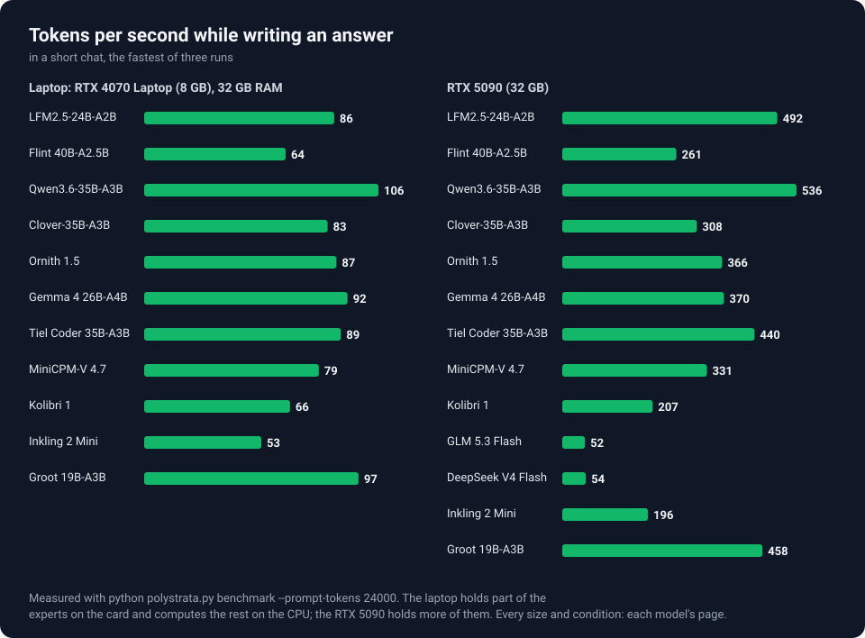

<h1 align="center">PolyStrata</h1>

[English](README.md) · **简体中文** · [日本語](README.ja.md) · [Deutsch](README.de.md) · [Français](README.fr.md) · [Español](README.es.md) · [Português](README.pt-BR.md) · [Türkçe](README.tr.md)

<p align="center"><b>在你自己的电脑上运行大型 AI 模型</b><br>
Qwen3.8-Flash-Next、Hy4-Flash、GLM 5.3 Flash、DeepSeek V4 Flash、LFM2.5、Flint、Qwen3.6、Clover、Ornith 1.5、Gemma 4、Tiel Coder、MiniCPM-V 和 Kolibri 1 · 免费开源</p>

<p align="center"><a href="https://github.com/simplexai-labs/linger"></a></p>

<p align="center"></p>

<p align="center"><br>
<sub>Claude Code 接 Qwen3.6-35B-A3B UD-Q3_K_M，在 8 GB 显卡的笔记本上，原速：给一个小程序加 <code>--json</code> 选项，写测试，跑测试。服务器启动时已经读过 Claude Code 的系统提示词（<code>"warm_start": true</code>）。</sub></p>

<p align="center"><br>
<sub><a href="https://github.com/simplexai-labs/linger">Linger</a> 接 PolyStrata：Inkling 2 Mini UD-Q3_K_XL 在 8 GB 显卡的笔记本上，每秒约 33 个 token，用 three.js 写出一个低多边形村庄的单文件网页，Linger 直接打开。</sub></p>

PolyStrata 能在普通电脑上运行通常要用服务器才能跑的大型 AI 模型。它们能聊天、写代码，还能配合你的应用和编程智能体一起工作。
所有数据都留在你的电脑上。

它能跑十四个模型，用两个引擎：

- **[Qwen3.8-Flash-Next](https://huggingface.co/Qwen/Qwen3.8-Flash-Next)**：12 GB 及以上的 NVIDIA 或 AMD 显卡，Windows 或
  Linux。它还能看图片。引擎是 Strata 项目的，没有改动。

另外十三个用的是为 PolyStrata 写的引擎，需要一张 NVIDIA 显卡，也可以用[两张](docs/MULTI_GPU.md#the-strata-poly-models)：十三个都能在 Linux 上跑，除了 GLM 5.3 Flash 和 DeepSeek V4 Flash，其余也都能在 Windows 上跑。
目前是实验性的：都在一台 32 GB 显卡的电脑上跑过，其中九个小的另外在一台 8 GB 显卡的笔记本上跑过，Groot 还在一台 8 GB 的 RTX 5060 上跑过。

- **[GLM 5.3 Flash](docs/models/glm.zh-CN.md)**：最大的一个，文件 79 到 114 GB，大部分留在内存里。
- **[DeepSeek V4 Flash](docs/models/deepseek.zh-CN.md)**：文件 91 GB，大部分也留在内存里。它记对话占的显存很少：128K 上下文只比 32K 多占 0.7 GB。
- **[LFM2.5-24B-A2B](docs/models/lfm25.zh-CN.md)**：Liquid AI 的模型，文件 11 到 25 GB。它大部分层没有注意力，所以长对话占的显存很少：
  128K 上下文只比 32K 多占 2 GB。它的许可证只允许年收入低于 1,000 万美元的公司商用。
- **[Flint 40B-A2.5B](docs/models/flint.zh-CN.md)**：Recursive 为编程智能体做的模型，文件 18 到 42 GB。它大部分层只往回看 513 个 token，
  所以长对话占的显存很少：128K 上下文只比 32K 多占 2.6 GB。
- **[Qwen3.6-35B-A3B](docs/models/qwen36.zh-CN.md)**：文件 13 到 23 GB。它还能看图片。
- **[Groot 19B-A3B 261023](docs/models/groot.md)**：实验性的安装支持，用 Bartowski 的三种量化 Q4_K_M、Q6_K 和 Q8_0（12.5 到 20.2 GB），带 MTP，图片投影可选。Q4_K_M 的文字在 8 GB 的 RTX 5060 上和 Linux 下的 RTX 5090 上跑过；图片、Q6_K 和 Q8_0 还没验证。
- **[Inkling 2 Mini](docs/models/inkling.md)**：Thinking Machines 的模型，实验性，文件 9 到 18 GB。在 Linux 上用 32 GB 的 NVIDIA 显卡、在 Windows 上用 8 GB 的笔记本显卡跑过，也能看图，一次只答一个请求。
- **[Clover-35B-A3B-Preview](docs/models/clover.zh-CN.md)**：DiffuSpace 的模型，在 Qwen3.6-35B-A3B 上接着训练，还能一次写出一整块 token，文件 13 到 21 GB。只看文字。
- **[Ornith 1.5](docs/models/ornith.zh-CN.md)**：结构和 Qwen3.6-35B-A3B 相同，权重不同，文件 14 到 24 GB。它还能看图片。
- **[Gemma 4 26B-A4B](docs/models/gemma4.zh-CN.md)**：文件 11 到 17 GB。它还能看图片。
- **[Tiel Coder 35B-A3B](docs/models/tiel.zh-CN.md)**：peculiar-ragdoll 为编程智能体量化的 Ornith 1.5，文件 14 到 23 GB。它还能看图片。
- **[MiniCPM-V 4.7 35B-A3B](docs/models/minicpmv.zh-CN.md)**：OpenBMB 的模型，结构和 Qwen3.6-35B-A3B 相同，权重是自己训练的，专门做看图，文件 16 到 29 GB。
- **[Kolibri 1](docs/models/kolibri.zh-CN.md)**：Aleph Alpha 的模型，写德语和写英语一样好，文件 29 到 48 GB，显卡小的时候大部分放在内存里。
- **[Hy4-Flash](https://github.com/Niko1221/Strata/releases/tag/v0.2.18)**：腾讯的 220B-A12B 模型，跑在 Strata 项目自己的引擎（`strata-hy4`）上，文件 130 到 181 GB，64 GB 内存起配 8 GB 显卡。也能看图。

服务器运行时可以在已安装的模型之间切换（[做法](docs/BACKENDS.md#changing-the-model)，英文）。

PolyStrata 由 [VecSzn](https://github.com/VecSzn) 创建。
PolyStrata 基于 Niko1221 的 [Strata](https://github.com/Niko1221/Strata)。
为什么单独开一个仓库、AMD 和显存更小的显卡、微调模型等问题，见 [FAQ](docs/FAQ.md)（英文）。

## 速度有多快？

一个 token 大约相当于 ¾ 个英文单词。

- **写回答：** 短对话中回复出现的速度。每秒 60 个 token 已经比你的阅读速度还快。
- **读提示：** 读入你发送内容的速度（文档、代码或聊天记录）。

下表是每个模型安装程序默认的规格，单位是每秒 token 数。每个规格的完整测速、和 llama.cpp 的对比、怎么测的，都在各模型自己的页面里。

| 模型 | 8 GB 显卡的笔记本<br>写回答 / 读提示 | RTX 5090<br>写回答 / 读提示 | 全部规格 |
| --- | ---: | ---: | --- |
| LFM2.5-24B-A2B | 86 / 4,035 | 492 / 25,275 | [LFM2.5](docs/models/lfm25.zh-CN.md) |
| Flint 40B-A2.5B | 64 / 2,643 | 261 / 15,033 | [Flint](docs/models/flint.zh-CN.md) |
| Qwen3.6-35B-A3B | 106 / 2,483 | 536 / 15,319 | [Qwen3.6](docs/models/qwen36.zh-CN.md) |
| Clover-35B-A3B-Preview | 83 / 2,242 | 308 / 13,918 | [Clover](docs/models/clover.zh-CN.md) |
| Ornith 1.5 | 87 / 2,362 | 366 / 14,438 | [Ornith](docs/models/ornith.zh-CN.md) |
| Gemma 4 26B-A4B | 92 / 2,187 | 370 / 11,478 | [Gemma 4](docs/models/gemma4.zh-CN.md) |
| Tiel Coder 35B-A3B | 89 / 2,517 | 440 / 15,109 | [Tiel Coder](docs/models/tiel.zh-CN.md) |
| MiniCPM-V 4.7 35B-A3B | 79 / 2,263 | 331 / 14,615 | [MiniCPM-V](docs/models/minicpmv.zh-CN.md) |
| Kolibri 1 | 66 / 851 | 207 / 6,133 | [Kolibri 1](docs/models/kolibri.zh-CN.md) |
| GLM 5.3 Flash | 跑不了，要 32 GB 显卡 | 52 / 863 | [GLM](docs/models/glm.zh-CN.md) |
| DeepSeek V4 Flash | 跑不了，要 32 GB 显卡 | 54 / 1,926 | [DeepSeek](docs/models/deepseek.zh-CN.md) |
| Inkling 2 Mini | 53 / 892 | 196 / 6,706 | [Inkling 2 Mini](docs/models/inkling.md) |
| Groot 19B-A3B 261023 | 97 / 2,785 | 458 / 15,634 | [Groot](docs/models/groot.md) |
| Hy4-Flash | 跑不了，要 64 GB 内存 | 90-111 / 1,694 | [Hy4-Flash](https://github.com/Niko1221/Strata/releases/tag/v0.2.18) |

笔记本：RTX 4070 Laptop（8 GB）、Core i7-14700HX、32 GB 内存。工作站：RTX 5090（32 GB）、Xeon Platinum 8470Q（25 vCPU）、90-120 GB 内存。Flint 在笔记本上是 UD-Q3_K_XL（32 GB 内存时安装程序选的规格），在工作站上是 UD-Q4_K_XL。Kolibri 1 两台上都是 Q2_K；安装程序在工作站上会选 Q4_K_M，这个规格没测。

Qwen3.8-Flash-Next 和 Hy4-Flash 用的是 [Strata](https://github.com/Niko1221/Strata) 的引擎，由 Strata 项目测得。Qwen3.8-Flash-Next 在 RTX 5070（12 GB）、64 GB 内存的电脑上：IQ2_XS 写 79、读 32K 提示 2,090（[全部规格](docs/models/qwen38.zh-CN.md)）。Hy4-Flash 在 RTX 5090 上：写 90 到 111，读 128K 提示 1,694（[它的发布说明](https://github.com/Niko1221/Strata/releases/tag/v0.2.18)）。

用 PolyStrata 自己引擎的这十一个模型，都是用它自带的跑分测的，你也可以在自己的电脑上跑：
`python polystrata.py benchmark --model <name> --prompt-tokens 24000`
（[它发什么、打印什么](docs/BACKENDS.md#benchmark)，英文）。
别人在自己的显卡上测的结果，以及怎么在你的电脑上和 llama.cpp 对比：
[社区测试结果](docs/COMMUNITY_BENCHMARKS.md#the-models-polystrata-adds)（英文）。
在笔记本上跑 Qwen3.6 和 Tiel Coder，PolyStrata 读提示比 llama.cpp b11540 快 2.7 到 3.5 倍，写快 1.5 到 1.8 倍
（[两次测试](docs/COMMUNITY_BENCHMARKS.md#comparing-with-llamacpp)，英文）。

## 占多少内存

从 0.1.45-poly.7 起，这十三个模型的引擎少占你的内存：已经放进显卡的那部分模型文件，它不再留在内存里。在笔记本上，
Qwen3.6-35B-A3B 读完 32,000 个 token 的提示后，0.1.45-poly.6 占 17.9 GiB，现在占 13.1 GiB，写的速度不变。Linux 上从
17.8 GiB 降到 12.6 GiB。

想再少占一些，在 `strata-<model>.json` 的 `"args"` 列表里加上 `"--ram-experts-mib", "6144"`
（[在哪](docs/INSTALL.md#where-things-are-stored)），然后重启。引擎就只给显卡外的专家留这么多 MiB 的内存，回答时也一样，
启动时会说一声。其余的留在系统的文件缓存里，别的程序可以拿这部分内存去用，哪个 token 用到时再从缓存读。专家放得进空闲内存时，
这个模式写得慢一些，所以默认关着，我们还在继续优化；放不进时，引擎会自己打开（见下）。笔记本（RTX 4070 Laptop 8 GB，32 GB 内存，Windows 11）上的 Qwen3.6-35B-A3B UD-Q3_K_M：

| | 默认 | `--ram-experts-mib 6144` |
| --- | ---: | ---: |
| 加载后引擎占的内存 | 11.7 GiB | **6.5 GiB** |
| 写的过程中最多：短对话 / 32K 提示后 | 14.3 / 14.0 GiB | **6.7 / 7.3 GiB** |
| 两次请求之间 | 12.8 GiB | **7.1 GiB** |
| 写的速度（token/秒）：第一次短对话 | 71.6 | 69.4（慢 3%） |
| 32K 提示后 | 65.4 | 63.7（慢 3%） |
| 之后再来一次短对话 | 84.2 | 72.9（慢 13%） |
| 长回答（短对话写 1,024 个 token） | 90.6 | 78.3（慢 14%） |

这次测的时候别的程序占了一部分显存，所以两列都比显卡空着时慢。另外两次测试里，32K 提示后慢 6% 到 8%，之后那次短对话慢
8% 到 10%。Linux 上（RTX PRO 6000 限到约 8 GB），它占 7.0 到 7.7 GiB，默认是 12.3 到 14.3 GiB，写得慢 7% 到 14%。把专家缓存
固定住（发布前就是这样检查的），回答逐个 token 都一样。

显卡外的专家放不进空闲内存时，引擎现在会拿“空闲内存减 4 GiB”当预算，留住最常用的专家，其余的等 token 用到时再从 SSD 读，
启动时会说一声。以前是全部映射，由系统一页一页缺页读回来。容器的内存上限也算在内。在 Linux 上测的：RTX PRO 6000 限到约 8 GB，
引擎的内存分别限到 12 GB 和 10 GB（16 GB 的电脑能留给它的量），每次启动前把模型文件清出文件缓存；Qwen3.6-35B-A3B UD-Q3_K_M，
第一次短对话、24,000 token 提示后、之后再一次短对话的写速度（token/秒）：

| 留给引擎的内存 | 全部映射（以前） | 现在自动取的预算 |
| --- | ---: | ---: |
| 12 GB | 51 / 75-78 / 94-98 | **57-60 / 77-85 / 131-139** |
| 10 GB | 39 / 48 / 69 | **51 / 64 / 92** |

不限内存时，同一台机器是 63 / 169 / 203。Windows 上跑的是同一段代码，但没有测。加上 `"--ram-experts-mib", "-1"` 就和以前一样全部映射。

反过来，加上 `"--lock-experts"` 会把显卡外的专家留在内存里，系统不能把这部分内存让给别的程序，引擎也就不用回头从 SSD
重读。只有一张 N 卡时，引擎加载时把它们拷进锁页内存，系统不会把它换出去，`ulimit -l` 也管不到它；之后离开显存的专家在两次
请求之间从模型文件拷进来。拷不了的情况（A 卡、Mac、模型层分在几张卡上、空闲内存不够）改为锁住模型文件的页面，Linux 上锁到
`ulimit -l` 为止，引擎启动那行会写出这个上限和调高的办法。

读提示用的显存也少了 350 到 400 MiB：要么给专家缓存（Qwen3.6 显存里的专家从 2,444 个变成 2,712 个），要么用
`--vram-reserve-mib` 留给别的程序。原理和测法见 [docs/BACKENDS.md](docs/BACKENDS.md#less-of-the-pcs-ram-and-vram)。

## 你需要什么

| 模型 | 显卡 | 内存（默认规格） | 硬盘 | 系统 |
| --- | --- | --- | --- | --- |
| [Qwen3.8-Flash-Next](docs/models/qwen38.zh-CN.md) | NVIDIA RTX 20-50 系列，或 AMD RX 6800 / 6900, RX 7700 XT / 7800 XT / 7900 XT / XTX, RX 9060 XT / 9070 / 9070 XT, Radeon AI PRO R9700，12 GB 起 | 32 GB 起，64 GB 能跑所有规格 | 约 80 GB | Windows、Linux |
| [GLM 5.3 Flash](docs/models/glm.zh-CN.md) | NVIDIA RTX 20 系列起，只在 32 GB 显卡上跑过 | 配 32 GB 显卡 96 GB | 79-114 GB，要 SSD | Linux |
| [DeepSeek V4 Flash](docs/models/deepseek.zh-CN.md) | 同上 | 配 32 GB 显卡 72 GB | 91 GB，要 SSD | Linux |
| [LFM2.5-24B-A2B](docs/models/lfm25.zh-CN.md) | NVIDIA RTX 20 系列起，8 GB 起 | 配 8 GB 显卡约 20 GB | 11-25 GB | Windows、Linux、Mac（测试版） |
| [Flint 40B-A2.5B](docs/models/flint.zh-CN.md) | 同上 | 配 8 GB 显卡约 22 GB | 18-42 GB | Windows、Linux |
| [Qwen3.6-35B-A3B](docs/models/qwen36.zh-CN.md) | 同上；AMD 是测试版 | 配 8 GB 显卡约 21 GB | 13-23 GB | Windows、Linux、Mac（测试版） |
| [Clover-35B-A3B-Preview](docs/models/clover.zh-CN.md) | NVIDIA RTX 20 系列起，8 GB 起 | 配 8 GB 显卡约 20 GB | 13-21 GB | Windows、Linux |
| [Ornith 1.5](docs/models/ornith.zh-CN.md) | 同上；AMD 是测试版 | 配 8 GB 显卡约 22 GB | 14-24 GB | Windows、Linux |
| [Gemma 4 26B-A4B](docs/models/gemma4.zh-CN.md) | 同上；AMD 是测试版 | 配 8 GB 显卡约 18 GB | 11-17 GB | Windows、Linux |
| [Tiel Coder 35B-A3B](docs/models/tiel.zh-CN.md) | 同上；AMD 是测试版 | 配 8 GB 显卡约 21 GB | 14-23 GB | Windows、Linux |
| [MiniCPM-V 4.7 35B-A3B](docs/models/minicpmv.zh-CN.md) | 同上；AMD 是测试版 | 配 8 GB 显卡约 25 GB | 16-29 GB | Windows、Linux |
| [Kolibri 1](docs/models/kolibri.zh-CN.md) | NVIDIA RTX 20 系列起，8 GB 起 | 配 8 GB 显卡约 33 GB | 29-48 GB | Windows、Linux |
| [Groot 19B-A3B 261023](docs/models/groot.md)（实验性） | CUDA/HIP 共用的后端；Q4_K_M 的文字在 8 GB 的 RTX 5060 上跑过（实测峰值显存 7.05 GiB、内存 21.8 GiB） | Q4_K_M 配 8 GB 显卡约 17 GB，安装程序估的 | 12.5-20.2 GB；看图再加 0.9 GB | Windows、Linux；图片、Q6_K、Q8_0 没验证 |
| [Inkling 2 Mini](docs/models/inkling.md)（实验性） | NVIDIA，8 GB 起；在 RTX 5090 和 RTX 4070 Laptop（8 GB，UD-Q3_K_XL）上跑过 | UD-Q4_K_XL 配 8 GB 显卡约 21 GB，安装程序估的 | 9-18 GB | Windows、Linux、Mac（测试版） |
| [Hy4-Flash](https://github.com/Niko1221/Strata/releases/tag/v0.2.18)（Strata 项目的引擎） | NVIDIA V100 到 RTX 50，8 GB 起；AMD RX 6000 到 9000 和 Strix Halo；Intel Arc | SQ-64 要 64 GB 起，SQ-96 要 96 GB，SQ-128 要 128 GB | 130-181 GB，放在 SSD 上 | Windows、Linux、Mac |

内存是安装程序的估算；显卡越大，要的内存越少。其他的都由安装程序搞定：在 Windows 上它直接下载编译好的引擎，CPU 不支持 AVX2、在 AMD 显卡上运行 PolyStrata 自己的模型，或你这份代码的引擎比最新 release 新时，才在本机编译，缺工具会问你要不要装。两到三张显卡可以分担同一个模型（[多 GPU](docs/MULTI_GPU.md)）。较老的显卡、Intel Arc、Apple 芯片的 Mac（Qwen3.8-Flash-Next，测试版还有 Qwen3.6、LFM2.5 和 Inkling 2 Mini）、Strix Halo、不支持 AVX2 的老处理器：[完整列表](docs/INSTALL.md#what-you-need)。每个模型的显卡、内存和各规格的细节在它自己的页面里。

Qwen3.6、Clover、Ornith 1.5、Gemma 4、Tiel Coder 和 MiniCPM-V 这六个模型各自需要什么、是怎么验证的：[docs/BACKENDS.md](docs/BACKENDS.md#install)（英文）。

## 安装

### 让你的 AI 帮你装

你在用 AI 编程助手吗（Claude Code、Cursor、Codex、GitHub Copilot 等）？把下面这段粘贴给它：

```text
Set up PolyStrata on this PC for me: https://github.com/simplexai-labs/PolyStrata - follow docs/AI_SETUP.md in that repository.
```

它会检查你的显卡、内存和硬盘，选出合适的模型。然后安装并启动它，再告诉你怎么连接你的应用。AI 工具也可以通过
PolyStrata 的 [MCP 服务器](docs/MCP_SERVER.md)来安装、启动和停止 PolyStrata。

### 或者自己动手

[下载 PolyStrata](https://github.com/simplexai-labs/PolyStrata/archive/refs/heads/main.zip) 并解压（或者用 `git clone`）。
**Windows：** 双击 **`START-HERE.bat`**。**Linux：** 在 PolyStrata 文件夹里运行 **`./setup.sh`**。

**Mac（Apple 芯片，M1 到 M5，macOS 15 或更新版本）：** 先安装一次 Apple 的 Command Line Tools（在终端里运行 `xcode-select --install`；不需要 Xcode 本身）。然后在 PolyStrata 文件夹里打开终端，运行 **`./setup.sh`**。它会在你的 Mac 上编译 Mac 版引擎（大约 7 分钟），问同样的问题，下载模型并启动。下次运行 `./setup.sh` 会马上启动。哪个大小适合你的 Mac、速度如何：[docs/MAC.md](docs/MAC.md)。默认装的是 Qwen3.8-Flash-Next。`./setup.sh --family qwen36` 或 `--family lfm25` 改装 Qwen3.6 或 LFM2.5，跑在 strata-poly 的 Metal 引擎上，算测试版：在 M5 Ultra 上，Qwen3.6 UD-Q2_K_XL 短对话每秒写 134 个 token，读 3,768 个 token 的提示每秒 2,978 个。`--family inkling` 用同样的方式装 Inkling 2 Mini：在 M5 Ultra 上，UD-Q3_K_XL 短对话每秒写 74 个 token，读 32,787 个 token 的提示每秒 2,440 个，之后每秒写 61 个；图片在 CPU 上读。安装程序在 Mac 上也提供 GLM、DeepSeek、Ornith、Gemma 4、Tiel Coder 和 MiniCPM-V，但还没在 Mac 上用真实权重跑过。Kolibri、Flint 和 Clover 需要 NVIDIA 或 AMD 显卡。

安装程序会识别你的显卡，并装好对应的引擎。它会问你几个问题：

- 用哪个模型、哪个规格，
- 上下文多大（模型能记住多少文字），
- 是否要识别图片（GLM 5.3 Flash、DeepSeek V4 Flash、LFM2.5、Flint、Clover 和 Kolibri 1 不支持）。

每次直接按回车就是推荐选项。之后它会下载模型（Qwen3.8-Flash-Next 约 70 GB，GLM 5.3 Flash 79 到 114 GB，DeepSeek V4 Flash 91 GB，Kolibri 1 29 到 48 GB，另外八个 11 到 42 GB）并启动。
如果下载中断了，再运行一次即可：它会从中断的地方继续。模型准备好后，API 地址是 `http://127.0.0.1:8080/v1`。
想用一个应用和它聊天的话，我们推荐 [Linger](https://github.com/simplexai-labs/linger)；支持 OpenAI 或 Anthropic API 的应用也都能用。

十四个模型都在安装程序的模型列表里。想直接装其中一个，运行 `./setup.sh --family glm`（或 `deepseek`、`lfm25`、`flint`、`qwen36`、`clover`、`ornith`、`gemma4`、`tiel`、`minicpmv`、`kolibri`、`groot`、`inkling`）
（[它会问什么、写什么](docs/GLM.md#install)）。

> **模型启动时，你的电脑可能会变慢或卡住 1-3 分钟**（第一次最久）。
> PolyStrata 会把 35-55 GB 加载到内存，并为显卡锁定其中一部分。这是正常的。请耐心等待，不要关闭窗口。
> 窗口里会显示 PolyStrata 正在做什么。

**下次使用时**，再运行一次 `START-HERE.bat`（或 `./setup.sh`）。它会马上启动，已下载的东西不会重复下载。关闭它的窗口就能停止模型。
`UPDATE.bat`（`./setup.sh --update`）只更新 PolyStrata，不启动。
从 0.1.45-poly.10 或更早版本更新的：setup 的文件已移到 `terminal/`（[要改什么](docs/INSTALL.md#coming-from-0145-poly10-or-older)）。
更新、多张显卡、文件存放位置以及所有选项：
[docs/INSTALL.md](docs/INSTALL.md)。

**想知道在你电脑上快不快？** 运行 `tools/BENCH.bat`（`tools/bench.sh`）：大约 5 到 10 分钟，用你自己的设置测聊天、4K/16K 提示和一段代理式会话，并写出一份可以分享的报告（[怎么做](docs/COMMUNITY_BENCHMARKS.md#run-the-benchmark)）。

## 该选哪个模型

同一个模型有几种规格，压缩程度不同：规格越小越快、要的内存越少，越大越接近原模型。安装程序会按你的内存和显卡选一个，直接按回车就行；想要别的规格，安装时加 `--model <规格>`。

| 模型 | 安装程序默认 | 内存不够时 | 要指名的规格 |
| --- | --- | --- | --- |
| [Qwen3.8-Flash-Next](docs/models/qwen38.zh-CN.md) | 32 GB 内存：Coder；48-64 GB：IQ2_XS；96 GB 起：IQ3_S |  | Q2_0、IQ3_XXS、Unsloth 的 4 到 8 bit |
| [GLM 5.3 Flash](docs/models/glm.zh-CN.md) | 3.0BIT | UD-IQ2_XXS，再不够 REAP50-Q3_K_M |  |
| [DeepSeek V4 Flash](docs/models/deepseek.zh-CN.md) | UD-IQ2_XXS（只有这一个） |  |  |
| [LFM2.5-24B-A2B](docs/models/lfm25.zh-CN.md) | UD-Q4_K_XL | UD-Q3_K_XL | QAD-Q4_0, UD-Q6_K_XL, Q8_0 |
| [Flint 40B-A2.5B](docs/models/flint.zh-CN.md) | 内存约 40 GB 起 UD-Q4_K_XL | UD-Q3_K_XL | UD-Q6_K_XL, Q8_0 |
| [Qwen3.6-35B-A3B](docs/models/qwen36.zh-CN.md) | UD-Q3_K_M | UD-Q2_K_XL | UD-Q4_K_M |
| [Clover-35B-A3B-Preview](docs/models/clover.zh-CN.md) | Q3_K_M | APEX-I-NANOPLUS | Q4_K_M |
| [Ornith 1.5](docs/models/ornith.zh-CN.md) | APEX-I-COMPACT | APEX-I-MINI | APEX-I-QUALITY |
| [Gemma 4 26B-A4B](docs/models/gemma4.zh-CN.md) | UD-Q3_K_M | UD-Q2_K_XL | UD-Q4_K_M, QAT-UD-Q4_K_XL |
| [Tiel Coder 35B-A3B](docs/models/tiel.zh-CN.md) | UD-Q3_K_XL | UD-IQ3_XXS | UD-Q4_K_XL |
| [MiniCPM-V 4.7 35B-A3B](docs/models/minicpmv.zh-CN.md) | Q4_K_M | mix_q3gud_im | Q6_K |
| [Kolibri 1](docs/models/kolibri.zh-CN.md) | 内存约 48 GB 起 Q4_K_M | Q2_K | Q3_K_M |
| [Groot 19B-A3B 261023](docs/models/groot.md) | Q4_K_M | — | Q6_K, Q8_0 |
| [Inkling 2 Mini](docs/models/inkling.md) | UD-Q4_K_XL | UD-Q3_K_XL | UD-Q2_K_XL |
| [Hy4-Flash](https://github.com/Niko1221/Strata/releases/tag/v0.2.18) | 内存 64 GB 起 SQ-64，96 GB 起 SQ-96，128 GB 起 SQ-128 |  |  |

每个规格是什么、下载多大、配不同显卡要多少内存、和最大规格比答案差多少：各模型的页面，从“速度有多快？”的表里点模型名。

## 使用方法

十四个模型的用法一样，都用同一套 API。

<p align="center"><a href="https://github.com/simplexai-labs/linger"></a><br>
<sub><a href="https://github.com/simplexai-labs/linger">Linger</a>：多个智能体共用一台电脑，用的是你已经登录好的浏览器。图片来自 Linger 项目。</sub></p>

- **作为你的个人智能体：** 我们推荐 [Linger](https://github.com/simplexai-labs/linger)。Mac（Apple 芯片）、Windows 和 Linux 版都在[它的最新版本](https://github.com/simplexai-labs/linger/releases/latest)里下载。
- **在终端里：** 在 PolyStrata 文件夹里运行 `python polystrata.py --model <name>`，就能和装好的模型聊天；
  `--list-models` 列出所有模型（[更多](docs/INSTALL.md#the-terminal)）。
- **在浏览器里：** `http://127.0.0.1:8080` 有实时 **Monitor**（监控模型和你的
  GPU/CPU/内存）、**Requests**（打开 [API 请求监视器](docs/DETAILS.md#api-request-monitor)后，在单独的标签页里打开它），以及 **About**（设置和地址）。
  装了不止一个模型时，可以用页面顶部的列表切换。
- **你的应用和编程智能体：** 添加一个“OpenAI 兼容”的提供商，base URL 填 **`http://127.0.0.1:8080/v1`**。
  API key 和模型名随便填都行。
  - 使用 Anthropic API 的应用：`http://127.0.0.1:8080/v1/messages`（Claude Code：
    `ANTHROPIC_BASE_URL=http://127.0.0.1:8080`，并在 `strata-<model>.json` 里加 `"anthropic_thinking": "on_request"`
    （[原因](docs/FAQ.md#can-i-use-it-with-claude-code-codex-or-other-apps)））。
  - Codex CLI 和其他使用 OpenAI Responses API 的应用：`/v1/responses`
    （[设置方法](docs/DETAILS.md#the-responses-api-and-codex-cli)）。
- **思考：** 在你的应用的“reasoning effort”设置里选择 **off、low、medium 或 high**。off 最快，
  high 最适合难题。
- **从手机或另一台电脑访问：** `START-HERE.bat --setup --host 0.0.0.0 --api-key <secret>`。一定要设置 key。

它们不一样的地方：

| | Qwen3.8-Flash-Next | GLM 5.3 Flash | DeepSeek V4 Flash | LFM2.5-24B-A2B | Flint 40B-A2.5B | Kolibri 1 | Qwen3.6-35B-A3B、Clover-35B-A3B-Preview、Ornith 1.5、Gemma 4 26B-A4B、Tiel Coder 35B-A3B、MiniCPM-V 4.7 35B-A3B |
| --- | --- | --- | --- | --- | --- | --- | --- |
| **图片** | 在安装时对“Images?”选是。然后在你的应用里附上图片。显存不到 24 GB 时，图片编码器在处理器上运行，NVIDIA 和 AMD 都一样。 | 暂时不支持。 | 只能处理文字。 | 只能处理文字。 | 只能处理文字。 | 只能处理文字。 | 在安装时对“Images?”选是，之后和 Qwen3.8-Flash-Next 一样。显存不到 16 GB 的卡上，图片编码器在处理器上跑，一张图片要几秒。Clover 只能处理文字。 |
| **多个请求** | 默认一次只回答一个，其他请求排队等待。设置 `"parallel": 2` 可以同时回答多个（[BATCHING.md](docs/BATCHING.md)）；在 12 GB 显卡上，这会让每个回答变慢。 | 一次只回答一个，其他请求排队等待。 | 一次只回答一个，其他请求排队等待。 | 一次只回答一个，其他请求排队等待。 | 一次只回答一个，其他请求排队等待。 | 一次只回答一个，其他请求排队等待。 | 一次只回答一个，其他请求排队等待。 |
| **多个对话** | 内存够的话，默认在内存里保留多个对话，所以后续消息和轮流发言的智能体几秒内就开始回答（[详情](docs/DETAILS.md#conversation-cache)）。 | 保留最近的一个对话。安装程序会问要不要在内存里保留多个，这样智能体和子代理轮流请求时不用重读提示（[原理](docs/GLM.md#several-conversations-at-once)）。 | 和 GLM 5.3 Flash 一样。 | 和 GLM 5.3 Flash 一样。 | 和 GLM 5.3 Flash 一样。 | 和 GLM 5.3 Flash 一样。 | 和 GLM 5.3 Flash 一样。 |
| **长提示** | 对话的第一条消息要完整读入，大约每 30,000 个 token 需要 1 分钟。 | 第一条消息要完整读入，大约每 30,000 个 token 需要 40 秒。 | 第一条消息要完整读入，大约每 30,000 个 token 需要 29 秒。 | 第一条消息要完整读入：30,000 个 token 在工作站上要 1.3 到 1.5 秒，在 8 GB 笔记本上要 8 到 10 秒。 | 第一条消息要完整读入：30,000 个 token 在工作站上约 2.3 秒，在 8 GB 笔记本上要 15 到 22 秒。 | 第一条消息要完整读入：30,000 个 token 用 Q2_K 在工作站上约 6 秒，在 8 GB 笔记本上约 40 秒。 | 第一条消息要完整读入：30,000 个 token，工作站要 4 到 5 秒，8 GB 显卡的笔记本要 14 到 27 秒。 |

更多：[文件存在哪里](docs/INSTALL.md#where-things-are-stored)、[API](docs/DETAILS.md#using-it)。

### 可选：整个模型都能放进内存时，单卡再提速

两个可选设置（来自 RubenTorney 的 #1904 和 #1905）。适用于只用一张显卡、并且内存能放下所有专家的情况（PolyStrata 的 arena 模式，例如 64 GB 电脑上的 Q2_0 或 IQ3_XXS）。打开 PolyStrata 的 `terminal` 文件夹里的配置文件 `strata-<model>.json`（[在哪里](docs/INSTALL.md#where-things-are-stored)），加入：

- **生成更快：** 在 `"args"` 列表里加 `"--adapt-async", "1"`。专家缓存改在辅助线程里更新，不再暂停回答。在 RTX 5070（Windows，Q2_0）上实测：生成 +4-5%，代码和长文档 +7-10%。回答可能与默认设置略有不同（但每次运行都一样）。
- **Windows 上读取提示更快：** 在 `"env"` 块里加 `"STRATA_PIN_BY_NEED": "1"`。Windows 只能为显卡锁定大约一半的内存；这个设置会先锁定显卡真正需要的专家。在 RTX 5070 上实测：读取提示 +4.4%。

```json
"args": [ ..., "--adapt-async", "1" ],
"env": { "STRATA_PIN_BY_NEED": "1" }
```

修改后重启 PolyStrata（`START-HERE.bat` 或 `./setup.sh`）。要撤销，删掉这两项即可。

## 出问题了？

- **PolyStrata 第一次启动时电脑卡死了。** 加载模型时这是正常的。请耐心等待，不要关闭窗口。
  10 分钟后还卡着？重启电脑，关掉其他程序再试一次，或者换一个更小的规格。
- **下载或安装时中断了。** 再运行一次 `START-HERE.bat`（或 `./setup.sh`）。它会从中断的地方继续。
- **非常慢，硬盘灯一直闪，或者提示“the engine stopped unexpectedly”。** 你的电脑可用内存不够。
  关掉其他程序（浏览器很占内存），或者换一个更小的规格（Q2_0 或 IQ2_XS）。
- **提示 8080 端口已被占用。** PolyStrata 已经在运行了。找一下它的窗口。

更多问题和解决办法：[docs/TROUBLESHOOTING.md](docs/TROUBLESHOOTING.md)。还是解决不了？提交一个
[issue](https://github.com/simplexai-labs/PolyStrata/issues)，并附上 `terminal` 文件夹里的 `strata-<model>.log`。发现了安全问题？
请私下报告：[SECURITY.md](SECURITY.md)。

## 它是怎么工作的？

这类模型通常运行在拥有数百 GB 显存的服务器上。而你的显卡只有 8-32 GB。PolyStrata 让模型装得下的办法是
**把工作分摊到整台电脑上**。可以想象一个厨房：常用的东西放在台面上，其余的放在储藏室里。

每个模型的原理图和说明：[docs/HOW_IT_WORKS_MODELS.zh-CN.md](docs/HOW_IT_WORKS_MODELS.zh-CN.md)。

## 基于 PolyStrata 构建

<p align="center"><a href="https://github.com/simplexai-labs/linger"></a><br>
<sub>28 秒看懂 Linger：它装好本地模型、连上你的应用，把邮件和会议变成记忆，发邮件前先问你。</sub></p>

**[Linger](https://github.com/simplexai-labs/linger)** 是一个开源的个人智能体，完全在你的电脑上运行，本地模型跑在 PolyStrata 上。它能在你的各个应用里找到你要的东西，记住重要的事，在你不在的时候把事情做完。[文档](https://docs.heylinger.com/) · [GitHub](https://github.com/simplexai-labs/linger)

你也基于 PolyStrata 做了东西？开一个 [issue](https://github.com/simplexai-labs/PolyStrata/issues)，我们会把它加到这里。

## 致谢与许可证

Qwen3.8-Flash-Next 来自 [Qwen 团队](https://huggingface.co/Qwen/Qwen3.8-Flash-Next)，由
[ISTA-DASLab](https://huggingface.co/ISTA-DASLab/Qwen3.8-Flash-Next-GSQ-RCO-GGUF)、UkisAI（Swift 1.5）
和 Unsloth 压缩。GLM 5.3 Flash 用的是
[neuralll](https://huggingface.co/neuralll/GLM-5.3-Flash-GSQ-RCO-3.0bit-Q4Kattn-GGUF)、Unsloth 和 patrickbdevaney 的文件。
Qwen3.6-35B-A3B 来自 Qwen 团队，Gemma 4 来自 Google，DeepSeek V4 Flash 来自 DeepSeek，用的都是 [Unsloth](https://huggingface.co/unsloth) 的量化版本。LFM2.5-24B-A2B 来自 [Liquid AI](https://huggingface.co/LiquidAI/LFM2.5-24B-A2B)，用的是 Unsloth 的量化版本和 Liquid AI 自己的 QAD-Q4_0。Flint 40B-A2.5B 来自 [Recursive](https://huggingface.co/RecursiveSI/flint)，用的是 Unsloth 的量化版本。Inkling 2 Mini 来自 [Thinking Machines](https://huggingface.co/thinkingmachines/Inkling-2-Mini)，用的是 Unsloth 的量化版本。Groot 19B-A3B 261023 来自 GrootTeam，用的是 [bartowski](https://huggingface.co/bartowski/GrootTeam_Groot-19B-A3B-261023-GGUF) 的量化版本。Kolibri 1 来自 [Aleph Alpha](https://huggingface.co/Aleph-Alpha/Kolibri-1)，用的是 [Hob-forge](https://huggingface.co/Hob-forge/Kolibri-1-GGUF) 转换的 GGUF。Clover-35B-A3B-Preview 来自 [DiffuSpace](https://huggingface.co/Diffuspace/Clover-35B-A3B-Preview)，用的是 [maternion](https://huggingface.co/maternion/Clover-35B-A3B-Preview-GGUF) 的量化版本和 IsValorum 的 APEX。Ornith 1.5 来自
ornith-ai，用的是 [mudler](https://huggingface.co/mudler/Ornith-1.5-35B-A3B-APEX-MTP-GGUF) 的 APEX 量化版本。Tiel Coder 35B-A3B 是 [peculiar-ragdoll](https://huggingface.co/peculiar-ragdoll/Tiel-Coder-35B-A3B-GGUF-MTP) 量化的 Ornith 1.5，[u/Sensitive_Song4219](https://www.reddit.com/r/LocalLLM/comments/1x22inc/comment/pf3r111/) 发现它能在 PolyStrata 上跑。MiniCPM-V 4.7 35B-A3B 来自 [OpenBMB](https://huggingface.co/openbmb/MiniCPM-V-4.7-35B-A3B-gguf)，用的是他们自己的量化版本，由 [iMilnb](https://github.com/iMilnb) 接入 PolyStrata。PolyStrata 基于
Niko1221 和各位贡献者的 [Strata](https://github.com/Niko1221/Strata)，并使用了
[llama.cpp / ggml](https://github.com/ggml-org/llama.cpp) 的部分代码。完整致谢：
[docs/HOW_IT_WORKS.md](docs/HOW_IT_WORKS.md#credits)。PolyStrata 以 [MIT 许可证](LICENSE)开源。少数部分和每个模型
有各自的许可证（[具体是哪些](docs/HOW_IT_WORKS.md#license)）。
